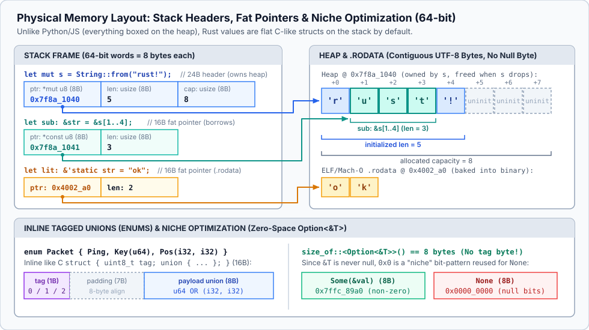
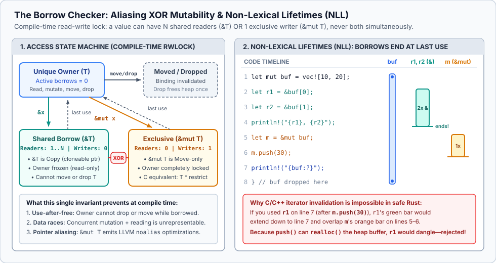
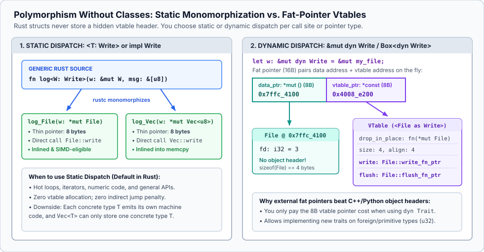
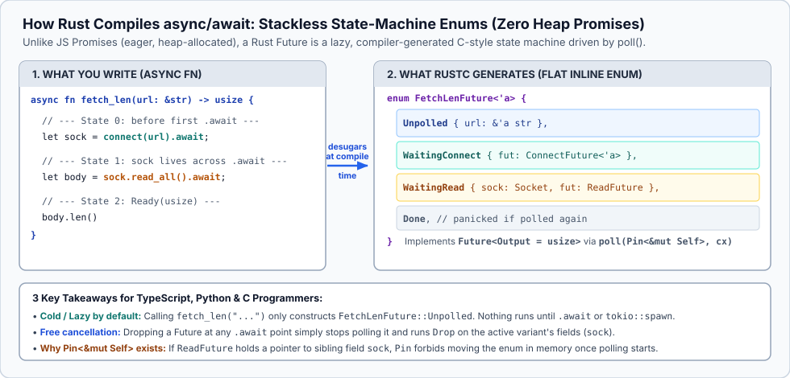

# Rust for C, Python, and TypeScript Experts

*Estimated reading time: 15–20 minutes*

If you already know **C**, **Python**, and **TypeScript**, you have lived on both sides of a classic language trade-off:

- **In C**, you get exact control over memory layout, stack frames, cache locality, and zero runtime overhead—paid for by manual lifetime tracking in your head and Undefined Behavior (UB) landmines (`use-after-free`, double `free`, buffer overruns, iterator invalidation, data races).
- **In Python and TypeScript**, you get expressive type systems (TS discriminated unions, generics), high-level ergonomics (Python iterators, closures, `async`/`await`), and memory safety—paid for by boxing values on the heap, pointer chasing, and garbage collection or reference counting.

**Rust’s core thesis** is that this trade-off is a false dichotomy. Rust compiles TypeScript-grade algebraic types and Python-grade iterator/closure pipelines directly down to C’s flat memory model—with no garbage collector and no hidden object headers—by enforcing two invariants at compile time:

1. **Affine Ownership + Deterministic Destruction (`Drop`):** Every value has a single owner (typically a stack frame or enclosing struct). Assignment *moves* ownership by copying stack bytes (`memcpy`) and statically invalidating the old binding. When the owner goes out of scope, the compiler inserts cleanup code deterministically—like C’s `goto cleanup` or Python’s `with` block, but automatic and impossible to forget.
2. **Aliasing XOR Mutability (`&T` vs. `&mut T`):** At any point in execution, a memory location may have *either* any number of shared read-only pointers (`&T`) *or* exactly one exclusive mutable pointer (`&mut T`)—never both simultaneously.

---

## 1. The 60-Second Rosetta Stone

| Concept | C | TypeScript | Python | Rust |
| :--- | :--- | :--- | :--- | :--- |
| **Default Value Storage** | Stack / inline in `struct` | Boxed on V8/JS heap | Boxed `PyObject*` on heap | Stack / inline in `struct` or `enum` |
| **Assignment (`b = a`)** | Shallow bitwise copy (`memcpy`) | Copies heap reference (aliases) | Copies `PyObject*` + `Py_INCREF` | **Moves** ownership (or bitwise copies if `T: Copy`) |
| **Resource Cleanup** | Manual `free()` / `close()` | Nondeterministic GC | Refcount (`Py_DECREF`) + cycle GC / `with` | Deterministic `Drop` at end of owner’s scope |
| **Pointers / References** | `T*`, `const T*`, `T* restrict` | Implicit object refs | Implicit object refs | Safe `&T` (shared), `&mut T` (exclusive); raw `*const T`, `*mut T` in `unsafe` |
| **Null / Absence** | `NULL` (`0x0`) | `T \| null \| undefined` | `Optional[T]` (`None`) | `Option<T>` (`Some(T)` or `None`, niche-optimized) |
| **Tagged Unions (ADTs)** | Manual `enum` tag + `union` | `{ kind: 'a', ... } \| { kind: 'b', ... }` | `A \| B` (`match` at runtime) | `enum` (inline flat memory, exhaustively matched) |
| **Error Handling** | Return `-1` / `errno` / `goto err` | `throw` / `try-catch` (untyped) | `raise` / `try-except` | `Result<T, E>` + `?` operator (early return) |
| **Polymorphism** | Function-pointer structs (`ops`) | `interface` (structural, erased) | Duck typing / `Protocol` | `trait` (nominal): static (`impl Trait`) or dynamic (`dyn Trait`) |
| **Vtable Location** | Manual struct of fn pointers | Hidden class (`Map`) on heap | `ob_type` pointer inside `PyObject` | **External** 16-byte fat pointer `(data_ptr, vtable_ptr)` |
| **Strings** | `char*` (null-terminated bytes) | UTF-16 immutable heap string | PEP 393 flexible Unicode object | `String` (owned UTF-8 `Vec<u8>`) & `&str` (UTF-8 fat slice) |
| **Async Execution** | `epoll` / `io_uring` state machines | Eager heap `Promise<T>` | Event-loop heap `Coroutine` | Lazy stackless state-machine `enum` polled by an executor |

---

## 2. Physical Memory Layout, Moves, and Strings

If you think of Rust variables like Python or JS variables, the borrow checker will feel arbitrary. Think of them like **C structs on the stack**, and every rule clicks immediately.



### Stack by Default, Explicit Heap
When you write:

```rust
struct Point {
    x: f64,
    y: f64,
}
```

`Point` is 16 contiguous bytes on the stack—no `PyObject` header, no V8 hidden class pointer, no heap allocation.
*One C difference:* By default (`#[repr(Rust)]`), the compiler is free to reorder struct fields to eliminate alignment padding. When passing structs across a C ABI boundary or memory-mapping hardware/network headers, annotate the struct with `#[repr(C)]`.

### Move vs. `Copy` vs. `Clone`: What `let b = a;` Really Does
Consider how `String` (a growable UTF-8 buffer) is laid out on a 64-bit machine. It is a 24-byte stack header `{ ptr: *mut u8, len: usize, cap: usize }` owning a heap buffer—identical to `Vec<u8>`.

What happens when you assign `let s2 = s1;`?

- **In Python/TypeScript:** `s2 = s1` copies an 8-byte pointer. Both bindings alias the same heap allocation.
- **In C:** `s2 = s1` copies the 24-byte struct on the stack. Now *both* `s1.ptr` and `s2.ptr` point to the same heap buffer. If both clean up at scope exit, you get a **double-free**.
- **In Rust:** `let s2 = s1;` copies the 24-byte header on the stack (`memcpy`, **not** a deep heap copy) and **statically marks `s1` as uninitialized (moved)**. Only `s2` will run its destructor (`Drop::drop`) when the scope exits.

```rust
fn main() {
    let s1 = String::from("rust!"); // allocates 5 bytes on heap
    let s2 = s1;                    // 24-byte stack memcpy; s1 is now dead
    // println!("{s1}");            // COMPILE ERROR: borrow of moved value: `s1`

    let s3 = s2.clone();            // Explicit deep heap allocation + copy
    println!("{s2} and {s3}");

    let x: i32 = 42;
    let y = x;                      // i32 implements `Copy`: x remains valid
    println!("{x} and {y}");
} // s3 and s2 drop here, each freeing its own heap buffer
```

Types fall into two categories:
- **Move types (the default):** `String`, `Vec<T>`, `Box<T>`, `File`, `MutexGuard`, and any `struct`/`enum` you define unless you opt in. Assignment transfers ownership.
- **`Copy` types:** Pure bit-blobs that own no external heap/OS resources—integers (`i32`, `u64`, `usize`), floats (`f64`), `bool`, `char`, shared references (`&T`), raw pointers (`*const T`), fixed-size arrays of `Copy` types (`[u8; 32]`), and user structs annotated with `#[derive(Copy, Clone)]`. For `Copy` types, `b = a` is a bitwise copy and `a` stays usable.

> **Mental shortcut:** In Rust, `memcpy` is the *only* implicit copy. Deep copies (`Clone::clone`) are always explicit in source code, and constructors do not exist (`Foo { a, b }` is just literal struct initialization).

### `String` vs. `&str` and `Vec<T>` vs. `&[T]` (Fat Pointers)
A C programmer constantly passes `(const uint8_t *buf, size_t len)` pairs around. Rust bakes that pair into a first-class primitive called a **slice**:

- `&[T]` is a 16-byte **fat pointer** `(ptr: *const T, len: usize)` borrowing a contiguous view of `T`s anywhere in memory (stack array, heap `Vec<T>`, or static binary data).
- `&str` is simply a `&[u8]` carrying a compile-time invariant that the bytes are valid **UTF-8**.
- Notice: Rust strings are **not null-terminated** (they can contain interior `\0` bytes, and taking a substring `&s[1..4]` is $O(1)$ with zero allocation—unlike C’s `strncpy`).

**API rule of thumb:** Never write `fn process(s: &String)` or `fn sum(v: &Vec<i32>)`. Always accept the slice view instead:

```rust
fn first_word(s: &str) -> &str {
    match s.find(' ') {
        Some(idx) => &s[..idx],
        None => s,
    }
}

fn main() {
    let owned = String::from("hello world");
    let word1 = first_word(&owned);        // &String automatically coerces to &str (via Deref)
    let word2 = first_word("literal str"); // &'static str works directly too
    assert_eq!(word1, "hello");
    assert_eq!(word2, "literal");
}
```

**Why can’t you index a string with `s[0]`?** Because UTF-8 is variable-width (`1` to `4` bytes per Unicode code point). `s[i]` would either be an $O(n)$ scan (like Python 2/UTF-8 scan) or return a raw byte that splits a multi-byte character (like C), or expose UTF-16 surrogates (like JS/TS). Rust forces you to say what you want:
- `s.as_bytes()[0]` — $O(1)$ raw `u8` byte access.
- `&s[0..4]` — $O(1)$ UTF-8 sub-slice (panics at runtime if byte index `4` falls mid-codepoint).
- `s.chars()` — iterator over 4-byte Unicode scalar values (`char`).

---

## 3. The Borrow Checker & Lifetimes (`'a`) Without Mysticism

Instead of transferring ownership every time you call a function, you pass **references** (`&T` and `&mut T`). At the machine level, a reference is just a non-null C pointer (`*const T` or `*mut T`, or a 2-word fat pointer for slices/trait objects).

At compile time, references obey **Aliasing XOR Mutability**—which you can picture as a **zero-cost compile-time `pthread_rwlock_t`** attached to every variable:



### Why C’s `const T*` Is Weak and Rust’s `&T` / `&mut T` Is Strong
In C, `const int *p` only means *"I promise not to mutate `*p` through `p`"*—nothing stops another pointer `int *q` in the same scope from mutating `*p` right underneath you. That is why C compilers cannot hoist loads across function calls without `restrict`.

In Rust:
- **`&T` (Shared Reference):** Freeze the referent. You can copy `&T` freely (`&T: Copy`), handing out 100 readers, **and Rust guarantees nobody is mutating the value anywhere**.
- **`&mut T` (Mutable Reference):** Exclusive access (`&mut T` is **not** `Copy`). While `&mut T` exists, nobody else can read or write the value—not even the original owner. Every `&mut T` automatically emits LLVM’s `noalias` attribute (a compiler-verified C `restrict`).

### Classic C/C++ Footgun Caught at Compile Time
Every C and C++ programmer has written this bug in some disguise: holding a pointer into a dynamic array while appending to it:

```rust
fn main() {
    let mut buf = vec![10, 20, 30];
    let first = &buf[0]; // Shared borrow (&i32) of `buf` starts
    buf.push(40);        // ERROR: `push` takes `&mut self` (may realloc() and free old heap buffer!)
    println!("{first}"); // Shared borrow still live here -> `first` would dangle!
}
```

`rustc` rejects this with a surgical diagram of the conflict:

```text
error[E0502]: cannot borrow `buf` as mutable because it is also borrowed as immutable
 --> src/main.rs:4:5
  |
3 |     let first = &buf[0];
  |                  --- immutable borrow occurs here
4 |     buf.push(40);
  |     ^^^^^^^^^^^^ mutable borrow occurs here
5 |     println!("{first}");
  |                ----- immutable borrow later used here
```

Notice **Non-Lexical Lifetimes (NLL):** if you move `println!("{first}");` *above* `buf.push(40);`, the program compiles! A borrow’s lifetime lasts only until its **last use in the control-flow graph**, not until the closing `}` of the block.

### Lifetimes (`'a`) Demystified
Lifetimes (`'a`, `'src`, `'static`) are the most misunderstood syntax in Rust. Two facts eliminate 90% of the confusion:

1. **Lifetimes do not exist at runtime.** They are erased before LLVM codegen; you cannot "extend" a value’s lifetime by changing `'a`.
2. **`'a` is just a generic parameter for scopes.** Just as TypeScript uses `<T>` to tell the typechecker how an output type relates to input types, Rust uses `<'a>` to tell the borrow checker **which input reference an output reference borrows from**.

When a function takes one reference and returns a reference (`fn first_word(s: &str) -> &str`), the compiler infers the relationship automatically (**lifetime elision**). You only write `'a` explicitly in two situations:

**Situation 1: Returning a reference that could come from multiple inputs.**
```rust
// Says: "The returned slice is valid for the intersection ('a) of x's and y's borrows."
fn longest<'a>(x: &'a str, y: &'a str) -> &'a str {
    if x.len() >= y.len() { x } else { y }
}
```

**Situation 2: Zero-copy structs that hold references.**
In C, storing a `const char*` inside a parsed struct is fast (zero allocations) but terrifying (if the backing buffer is freed first, every struct field dangles). In Rust, you parameterize the struct over the buffer’s lifetime `'src`:

```rust
#[derive(Debug, PartialEq)]
struct Header<'src> {
    name: &'src str,  // Borrows directly from the input buffer
    value: &'src str, // Zero heap allocations!
}

fn parse_header<'src>(line: &'src str) -> Option<Header<'src>> {
    let (name, value) = line.split_once(':')?;
    Some(Header {
        name: name.trim(),
        value: value.trim(),
    })
}
```
The `'src` annotation proves at compile time that no `Header<'src>` instance can ever outlive the `line` buffer it slices into.

---

## 4. Expressions, Algebraic Types (`enum`), and Pattern Matching

### Everything Is an Expression
Rust is an expression-oriented language. `if`, `match`, `{ ... }` blocks, and even `loop` evaluate to values.
- A block’s value is its final expression **without a trailing semicolon**.
- Adding a semicolon turns an expression into a statement whose value is `()`—the **unit type** (a zero-byte type `sizeof(()) == 0` that unifies C’s `void` and Python’s `None` without needing special compiler cases).

```rust
let port: u16 = if let Ok(val) = std::env::var("PORT") {
    val.parse().unwrap_or(8080) // no semicolon -> yields value
} else {
    8080
};
```

### `struct` + `impl`: Explicit Receivers Like Python, Static Layout Like C
Rust has no `class` keyword and no implementation inheritance (`extends`). Data lives in `struct` or `enum`; methods live in `impl` blocks. Like Python, methods declare `self` explicitly—using ownership modes to express what the method needs:

- `&self` (short for `self: &Self`): shared read-only borrow (most methods).
- `&mut self`: exclusive mutable borrow.
- `self`: **consumes** the receiver by value (great for state transitions, e.g., `connection.close(self)` or `builder.build(self)`—calling any method on `connection` afterward is a compile error!).

### `enum`: C `union` Efficiency + TypeScript Discriminated Union Safety
In TypeScript, discriminated unions are a superpower:
```ts
type Frame =
  | { kind: "ping" }
  | { kind: "text"; payload: string }
  | { kind: "binary"; flags: number; data: Uint8Array };
```
In Rust, `enum` gives you the exact same algebraic expressiveness and exhaustiveness checking, but laid out in flat inline memory like a C `struct { uint8_t tag; union { ... }; }`:

```rust
enum Frame {
    Ping,
    Text(String),
    Binary { flags: u8, payload: Vec<u8> },
}
```

And you **cannot** read a variant’s payload without pattern-matching its discriminant first:

```rust
fn payload_size(frame: &Frame) -> usize {
    match frame {
        Frame::Ping => 0,
        Frame::Text(s) => s.len(),
        // Match specific field values + destructure + guard clauses:
        Frame::Binary { flags: 0x01, payload } => payload.len(),
        Frame::Binary { payload, .. } if !payload.is_empty() => payload.len() + 1,
        Frame::Binary { .. } => 0,
    }
}
```

When you only care about one variant—especially for early-return guard clauses—use `if let` or **`let ... else`** (where the `else` block must diverge via `return`, `break`, `continue`, or `panic!`):

```rust
fn handle_text(frame: &Frame) -> Result<&str, &'static str> {
    let Frame::Text(body) = frame else {
        return Err("expected a Text frame");
    };
    Ok(body) // `body: &String` is bound in the outer scope!
}
```

### Niche Optimization: Why `Option<&T>` Costs Zero Extra Bytes
Rust has no `NULL` for safe references (`&T`, `&mut T`, `Box<T>`). When a value may be absent, you wrap it in `Option<T>`:

```rust
pub enum Option<T> {
    None,
    Some(T),
}
```

A C programmer immediately asks: *"Does `Option<&T>` double my pointer size from 8 bytes to 16 bytes with a tag + padding?"*
**No.** Because `&T`, `&mut T`, `Box<T>`, `fn()` pointers, and `NonZeroU64` have invalid bit patterns (`0x0` is never a valid reference), the compiler uses `0x0` to represent `None` (**niche optimization**). `size_of::<Option<&T>>()` is **8 bytes**, and `Option<&T>` has the exact same ABI representation as a nullable C pointer `const T*`!

---

## 5. Error Handling: `Result<T, E>` and the `?` Operator

Rust does not use exceptions for recoverable errors (unlike Python/TS, where any function call might invisibly unwind the stack), nor does it use C’s error codes + out-pointers (where forgetting to check a return value silently corrupts state).

Instead, fallible functions return `Result<T, E>`:

```rust
#[must_use] // Compiler warns if you ignore a returned Result!
pub enum Result<T, E> {
    Ok(T),
    Err(E),
}
```

### The `?` Operator: C’s `goto cleanup` Perfected
In C, clean resource management in a multi-step function requires a cascade of `if ((err = step()) != 0) goto cleanup;` labels. In Rust, the postfix `?` operator unwraps `Ok(val)` or immediately returns `Err(From::from(err))` to the caller—while **RAII `Drop` automatically cleans up every local resource** in reverse declaration order:

```rust
use std::fs::File;
use std::io::{self, Read};
use std::path::Path;

#[derive(Debug)]
enum ConfigError {
    Io(io::Error),
    MissingPort,
    InvalidPort(std::num::ParseIntError),
}

// Implementing `From` lets `?` automatically convert sub-errors into `ConfigError`
impl From<io::Error> for ConfigError {
    fn from(e: io::Error) -> Self { Self::Io(e) }
}
impl From<std::num::ParseIntError> for ConfigError {
    fn from(e: std::num::ParseIntError) -> Self { Self::InvalidPort(e) }
}

fn read_port(path: &Path) -> Result<u16, ConfigError> {
    let mut raw = String::new();
    // 1. Opens File; 2. Reads into `raw`; 3. Closes File descriptor on drop—even on Err!
    File::open(path)?.read_to_string(&mut raw)?;

    let Some(port_str) = raw.lines().find_map(|l| l.strip_prefix("port=")) else {
        return Err(ConfigError::MissingPort);
    };
    Ok(port_str.trim().parse::<u16>()?)
}
```

> **Ecosystem standard:** In real projects, nobody hand-writes `impl From` boilerplate for errors:
> - **Libraries** use [`thiserror`](https://docs.rs/thiserror) (`#[derive(thiserror::Error, Debug)]` with `#[from]` and `#[error("...")]` attributes) so callers get strongly typed error enums.
> - **Applications/CLIs** use [`anyhow`](https://docs.rs/anyhow) (`anyhow::Result<T>` + `.context("failed to read config")?`), which works like an ergonomic, type-erased error with backtraces.
> - **`panic!`** (and `.unwrap()` / `.expect("reason")`) is reserved for **programmer bugs / invariant violations** (like an out-of-bounds array index `v[99]`) or tests/prototypes.

---

## 6. Polymorphism: Traits, Monomorphization, and Fat-Pointer Vtables

Rust replaces classes, interfaces, and C function-pointer tables with **traits**. A `trait` defines shared behavior—similar to a TypeScript `interface` or Python `Protocol`, plus default method implementations and associated types.

```rust
trait Codec {
    fn encode(&self, out: &mut Vec<u8>);

    // Default method implementation:
    fn to_bytes(&self) -> Vec<u8> {
        let mut buf = Vec::new();
        self.encode(&mut buf);
        buf
    }
}
```

**The Orphan Rule (Coherence):** You can implement a `trait` for a `type` if and only if **either the trait or the type is defined in your crate**. You can implement *your* `Codec` trait for Rust’s `u64` or `String`, or implement Rust’s `Display` trait for *your* `Packet` struct—but you cannot implement `Display` for `Vec<u8>`. This guarantees linking two crates can never cause conflicting trait implementations.

### Static Dispatch (`<T: Trait>`) vs. Dynamic Dispatch (`&dyn Trait`)
In Python, Java, or C++ (`virtual`), polymorphism is decided **when defining the class**, and every instance carries an object header / `vptr` in memory.

In Rust, structs have **zero** vtable overhead in memory, and **the caller/API chooses** between compile-time monomorphization and runtime vtable dispatch:



```rust
use std::io::Write;

// 1. STATIC DISPATCH (Monomorphized — zero runtime overhead, inlined per concrete W)
//    `w: &mut impl Write` is syntactic sugar for `<W: Write>(w: &mut W)`
fn write_header_static<W: Write>(w: &mut W) -> std::io::Result<()> {
    w.write_all(b"MAGIC\n")
}

// 2. DYNAMIC DISPATCH (16-byte fat pointer `(data_ptr, vtable_ptr)` — one compiled function)
fn write_header_dynamic(w: &mut dyn Write) -> std::io::Result<()> {
    w.write_all(b"MAGIC\n")
}

// 3. HETEROGENEOUS COLLECTION via Box<dyn Write> (fat pointer owning heap allocation)
fn flush_all(writers: &mut [Box<dyn Write>]) -> std::io::Result<()> {
    for w in writers {
        w.flush()?;
    }
    Ok(())
}
```

### Standard Library Traits You Will See Everywhere
Most boilerplate traits can be auto-generated with `#[derive(Debug, Clone, PartialEq, Eq, Hash, Default)]`:

| Trait | Python / TS / C Equivalent | What It Enables |
| :--- | :--- | :--- |
| `Debug` / `Display` | `__repr__` / `__str__` | `println!("{x:?}")` (developer representation) vs. `println!("{x}")` (user-facing) |
| `Clone` / `Copy` | `.copy()` / `memcpy` | Explicit `.clone()` vs. implicit bitwise duplication on assignment |
| `Drop` | `__exit__` / C cleanup | Deterministic destructor `fn drop(&mut self)` called at scope exit |
| `PartialEq`, `Eq`, `Hash` | `__eq__`, `__hash__` | `==` operator and using the type as a `HashMap<K, V>` key |
| `From<T>` / `Into<U>` | Type-safe conversion | `let s = String::from("hi");` / generic APIs taking `impl Into<String>` |
| `Deref<Target = U>` | Smart pointer auto-deref | Why `&String` coerces to `&str`, `&Vec<T>` to `&[T]`, and `&Box<T>` to `&T` |

---

## 7. Closures & Zero-Cost Iterators: Python Ergonomics, C Assembly

In Python, list comprehensions and generator pipelines (`(x * x for x in nums if x > 0)`) are a joy to write, but each step crosses the bytecode interpreter and allocates `PyObject`s. In Rust, iterator pipelines look almost identical—and compile down to the exact same (or faster, bounds-check-elided SIMD) machine code as a hand-rolled C `for` loop:

```rust
fn top_positive_squares(nums: &[i64], limit: usize) -> Vec<i64> {
    nums.iter()               // yields &i64
        .copied()             // yields i64 (by value)
        .filter(|&x| x > 0)   // lazy adapter struct: Filter<...>
        .map(|x| x * x)       // lazy adapter struct: Map<Filter<...>>
        .take(limit)          // lazy adapter struct: Take<Map<Filter<...>>>
        .collect()            // consumes pipeline into Vec<i64> (type inferred from return!)
}
```

### The Three Iteration Modes
Collections provide three iterator methods corresponding to the three ownership modes:
1. **`v.iter()`** (or `for x in &v`) $\rightarrow$ yields shared references **`&T`**.
2. **`v.iter_mut()`** (or `for x in &mut v`) $\rightarrow$ yields mutable references **`&mut T`**.
3. **`v.into_iter()`** (or `for x in v`) $\rightarrow$ **consumes `v`** and yields owned values **`T`**.

### How Closures Work Without a Garbage Collector (`Fn`, `FnMut`, `FnOnce`)
In Python and TypeScript, a closure (`x => x + threshold`) heap-allocates a scope/cell object to hold captured variables.
In Rust, a closure `|x| x + threshold` compiles into an **anonymous stack `struct`** containing the captured variables! By default, the compiler captures variables in the least restrictive way needed, classifying the closure into a hierarchy of three traits:

- **`Fn`** (subtrait of `FnMut`): Captures state via shared reference `&T`. Can be called any number of times, even concurrently across threads.
- **`FnMut`** (subtrait of `FnOnce`): Captures state via mutable reference `&mut T`. Can be called repeatedly to mutate its environment (e.g., a counter closure).
- **`FnOnce`**: Consumes captured values by moving them out of the closure struct. Can only be called **once**.

Adding the **`move`** keyword (`move |x| ...`) forces the closure struct to **take ownership** of its captured variables by value instead of borrowing them from the enclosing stack frame—which is required whenever a closure outlives the current stack frame (such as spawning a thread or returning a closure).

---

## 8. When the Borrow Checker Says No: Smart Pointers & Interior Mutability

A strict tree of single owners works for 90% of data structures, but what if you are building a graph, an LRU cache, shared state across callbacks, or mutating a lazy cache inside a read-only `&self` method?

Rust does not ban shared ownership or mutation through shared references. Instead, it requires you to **pick the exact runtime pointer and synchronization mechanism** via standard library wrapper types:

| Type | Ownership | Thread-Safe? | What It Does & Runtime Cost |
| :--- | :--- | :--- | :--- |
| **`Box<T>`** | Single owner | Yes (if `T: Send`) | Heap allocation (`malloc`/`free`) owned by a single 8-byte stack pointer. Used for recursive types, large structs, or `Box<dyn Trait>`. |
| **`Rc<T>`** | Shared (`1..N`) | **No** (`!Send`) | Single-threaded reference counting (like Python’s `ob_refcnt`). Cloning increments a non-atomic counter (`usize`) and yields a shared `&T`. Use `rc::Weak<T>` to break cycles. |
| **`Arc<T>`** | Shared (`1..N`) | **Yes** (`Send + Sync`) | **Atomic** Reference Counting (`atomic_fetch_add`). Standard way to share heap data across threads or `async` tasks. |
| **`Cell<T>`** | Interior mutability | **No** (`!Sync`) | Zero-cost mutation through `&Cell<T>` by moving/copying values in and out (`.get()`, `.set()`). Never hands out a `&T` into the cell, so pointers can never dangle. |
| **`RefCell<T>`** | Interior mutability | **No** (`!Sync`) | Moves the borrow checker (`&T` XOR `&mut T`) to **runtime** via a borrow counter. `.borrow()` returns `Ref<T>`; `.borrow_mut()` returns `RefMut<T>`. Panics if both coexist at runtime. |
| **`Mutex<T>` / `RwLock<T>`** | Interior mutability | **Yes** (`Sync`) | OS/futex lock **wrapping the data `T` itself**. Calling `.lock()` blocks and returns a `MutexGuard<T>` that derefs to `&mut T` and unlocks automatically on drop. |
| **`Cow<'a, B>`** | Borrow-or-Own | Yes | **Clone-on-Write** enum (`Borrowed(&'a B)` or `Owned(B::Owned)`). Zero allocations if you only read; clones into an owned buffer the first time you mutate. |

> **Why Rust’s `Mutex<T>` is a revelation for C programmers:**
> In C, a `pthread_mutex_t lock;` sits *next to* `struct state data;` by mere comment convention—nothing stops a new teammate from touching `data` without locking `lock`, or forgetting `pthread_mutex_unlock` on an early `return`.
> In Rust, the data lives **inside** `Mutex<State>`. You literally do not have a pointer to `State` until you call `let mut guard = mutex.lock().unwrap();`, and you cannot forget to unlock it because `guard`’s `Drop` releases the lock at scope exit.
> Need shared mutable state across single-threaded callbacks? Combine **`Rc<RefCell<T>>`**. Across threads? Combine **`Arc<Mutex<T>>`**.

---

## 9. Fearless Concurrency & Poll-Based `async`/`await`

### `Send`, `Sync`, and Scoped Threads
How does Rust prevent data races at compile time? Through two auto-implemented marker traits:
- **`Send`:** A type is `Send` if ownership of it can safely be transferred to another thread. Almost everything is `Send` *except* non-atomic `Rc<T>`, raw pointers `*const T`, and OS thread-local handles (like `MutexGuard`).
- **`Sync`:** A type is `Sync` if it is safe for multiple threads to hold `&T` simultaneously (`T` is `Sync` $\iff$ `&T` is `Send`). Primitives, immutable structs, `Mutex<T>`, and `AtomicU64` are `Sync`; `Cell<T>` and `RefCell<T>` are `!Sync`.

If you try to capture an `Rc<T>` inside `thread::spawn(move || ...)`, the program fails to compile because `Rc<T>` is not `Send`—preventing non-atomic reference count corruption before your code ever runs.

Even better, **`std::thread::scope`** lets you spawn threads that **directly borrow local stack variables** without `Arc` or heap allocation, because the scope guarantees all spawned threads join before the scope exits:

```rust
use std::sync::Mutex;
use std::thread;

fn parallel_sum(data: &[u64]) -> u64 {
    let (left, right) = data.split_at(data.len() / 2);
    let total = Mutex::new(0u64);

    // `thread::scope` joins all child threads before returning, so threads
    // can safely borrow `left`, `right`, and `&total` from the parent stack!
    thread::scope(|s| {
        for chunk in [left, right] {
            let total_ref = &total;
            s.spawn(move || {
                let partial: u64 = chunk.iter().sum();
                *total_ref.lock().unwrap() += partial;
            });
        }
    });

    total.into_inner().unwrap() // Consumes Mutex with zero locking once threads have joined
}
```

### How Rust `async`/`await` Differs from TypeScript and Python
In TypeScript and Python (`asyncio`), `async`/`await` is built around an implicit global runtime and heap-allocated `Promise` / `Task` objects. Rust’s `async`/`await` is designed for systems programming where even an embedded microcontroller with no heap can run `async` code:



Four critical differences from TypeScript and Python:

1. **Futures are cold (lazy):** In TypeScript, calling `const p = fetch(url);` starts the network request immediately. In Rust, calling `let fut = fetch(url);` **does nothing** except construct the initial `FetchFuture::Unpolled` enum on the stack. Work only advances when you `.await` it or pass it to `tokio::spawn(...)`.
2. **State machines, not heap callbacks:** Each `async fn` compiles into a single flat `enum` whose size is the largest set of variables live across any `.await` point. Waiting on a composite future (`tokio::join!(a, b)`) requires zero extra heap allocations.
3. **Bring your own executor:** Rust’s standard library defines the `Future` trait, not the event loop (`epoll`/`kqueue`/`io_uring` reactor). In practice, [**Tokio**](https://tokio.rs) is the de facto standard multi-threaded work-stealing runtime (`#[tokio::main]`).
4. **Cancellation is just `Drop`:** Dropping a future (e.g., via `tokio::time::timeout(dur, fut).await`) stops polling it at its current `.await` point and runs `Drop` on its live local variables. And because worker threads multiplex thousands of tasks, **never block an `async` thread with heavy CPU work or synchronous syscalls**—offload those to `tokio::task::spawn_blocking` or `rayon`.

---

## 10. Escape Hatches & Tooling: `unsafe`, C FFI, and Cargo

### What `unsafe` Actually Does (and Doesn’t Do)
Safe Rust is intentionally conservative: if the compiler cannot prove a memory access is sound, it rejects the program. When you are writing an OS kernel, a custom allocator, SIMD intrinsics, or C FFI, you use an `unsafe { ... }` block.

**Crucial misconception:** `unsafe` does **not** turn off the borrow checker (`&T` and `&mut T` are still checked normally inside `unsafe`!). It only unlocks **five specific operations**:
1. Dereferencing raw pointers (`*const T` and `*mut T`).
2. Calling an `unsafe fn` (including C `extern` functions and intrinsics).
3. Implementing an `unsafe trait` (like `Send` or `Sync`).
4. Accessing or modifying a mutable `static` variable.
5. Accessing fields of a raw C-style `union`.

The idiomatic Rust pattern is **encapsulating a small, auditable `unsafe` block inside a 100% safe function signature**. Here is how the standard library’s `slice::split_at_mut` splits one mutable slice `&mut [T]` into two disjoint mutable slices `(&mut [T], &mut [T])`—something the borrow checker cannot prove on its own because it only sees `slice` borrowed mutably twice:

```rust
pub fn split_at_mut<T>(slice: &mut [T], mid: usize) -> (&mut [T], &mut [T]) {
    let len = slice.len();
    assert!(mid <= len, "mid out of bounds"); // Safe runtime check upholds invariant!
    let ptr = slice.as_mut_ptr();             // *mut T raw pointer

    // SAFETY: We asserted `0 <= mid <= len`, so `[0..mid)` and `[mid..len)`
    // are valid, initialized, and strictly non-overlapping sub-ranges.
    unsafe {
        (
            std::slice::from_raw_parts_mut(ptr, mid),
            std::slice::from_raw_parts_mut(ptr.add(mid), len - mid),
        )
    }
}
```
Notice the `// SAFETY:` comment convention: every `unsafe` block in serious Rust code documents the exact proof obligations that make Undefined Behavior impossible for *any* inputs passed to the outer safe function.

### Calling C, Python, and TypeScript
Because Rust has no garbage collector or mandatory runtime, it speaks the C ABI natively with **zero marshaling overhead**:

```rust
#[repr(C)]
pub struct Vec2 {
    pub x: f64,
    pub y: f64,
}

// 1. Calling a C library function from Rust:
unsafe extern "C" {
    fn hypot(x: f64, y: f64) -> f64;
}

// 2. Exporting a Rust function to C / Python ctypes / Node FFI:
#[unsafe(no_mangle)]
pub extern "C" fn vec2_length(v: Vec2) -> f64 {
    unsafe { hypot(v.x, v.y) }
}
```

And if you are accelerating Python or TypeScript bottlenecks in Rust:
- **For Python (`PyO3` + `maturin`):** Annotate Rust functions/structs with `#[pyfunction]` / `#[pyclass]` and run `maturin develop` to build a native Python extension module (how `pydantic-core`, `polars`, `ruff`, and `uv` are built).
- **For TypeScript / Node / Browser (`napi-rs` & `wasm-bindgen`):** Compile Rust directly to native Node `.node` addons or WebAssembly modules with auto-generated `.d.ts` TypeScript definitions.

### The 30-Second Cargo & Toolchain Survival Kit
If you have used `uv` in Python or `npm`/`pnpm` in TypeScript, `cargo` is the unified build system, package manager, test runner, linter, and doc generator that inspired modern tooling:

| Command | What It Does |
| :--- | :--- |
| `cargo new my_app` / `--lib` | Scaffolds a binary or library crate (`Cargo.toml` + `src/`) |
| `cargo check` | Runs type & borrow checking **without** LLVM codegen (10× faster iteration loop) |
| `cargo test` | Compiles and runs unit tests (`#[test]`), integration tests, and **every code block in doc comments** |
| `cargo clippy` | Runs hundreds of semantic & performance lints (mandatory in idiomatic Rust) |
| `cargo doc --open` | Builds offline HTML documentation for your crate and every dependency in `Cargo.lock` |
| `cargo +nightly miri test` | Runs tests inside **Miri** (an interpreter that deterministically catches UB, leaks, and aliasing violations in `unsafe` code—like Valgrind + ASan + TSan on steroids) |
| `rustc --explain E0502` | Prints a detailed, example-rich explanation of any compiler error code |
