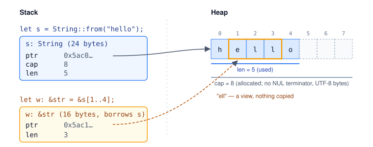
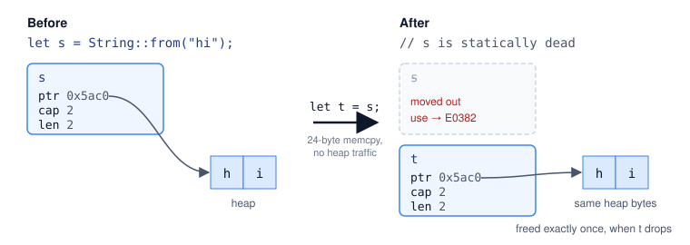
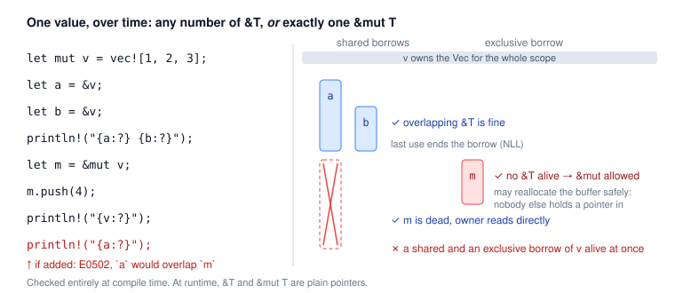
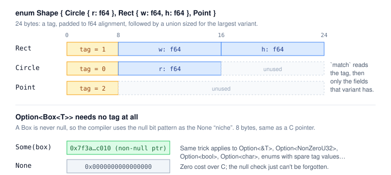
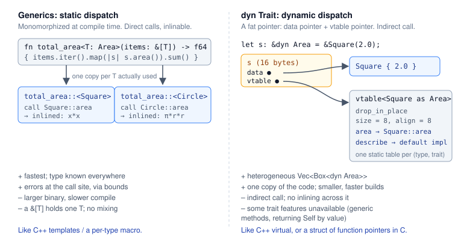

# Rust for people who already know C, Python and TypeScript

*A condensed introduction. About 15–20 minutes. Assumes you are fluent in C, Python and TypeScript; C++ is not required.*

Rust is a compiled, statically typed systems language with no garbage collector and no runtime to speak of. It gives you C's control over memory and layout, a type system closer to TypeScript's (and richer), and an expression-oriented, iterator-heavy style that will feel familiar from Python. What makes it different from everything you already know is a single idea: **the compiler tracks who owns every value and who is allowed to touch it, and it refuses to build programs where that bookkeeping doesn't add up.** Most of this document is about that idea and its consequences. The rest is a tour of what you'd expect from a modern language, with pointers to where Rust differs from your intuitions.

This is current as of Rust 1.99 (September 2026), edition 2024.

---

## 1. Orientation

- **Toolchain.** `rustup` installs and manages compilers. `cargo` is the build tool, package manager, test runner and doc generator; you will almost never invoke `rustc` directly. Packages are *crates*, published to crates.io, declared in `Cargo.toml`. `cargo new foo && cd foo && cargo run` is the whole hello-world ritual.
- **Releases.** A new stable compiler every six weeks, with strong backward-compatibility guarantees. *Editions* (2015, 2018, 2021, 2024) let the language make small breaking syntax changes; crates on different editions interoperate freely, and `cargo fix --edition` migrates you.
- **Compilation model.** Ahead-of-time to native code via LLVM. Monomorphized generics (like C++ templates, unlike TS or Python), so abstractions typically cost nothing at runtime. Compile times are the price, and they are noticeable.
- **No undefined behavior in safe code.** Out-of-bounds indexing panics deterministically instead of corrupting memory. Integer overflow panics in debug builds and wraps in release builds (or use explicit `wrapping_add`, `checked_add`, `saturating_add`). Null does not exist; uninitialized reads cannot be expressed; data races are compile errors.
- **Panics vs errors.** A *panic* is for bugs (like a failed `assert`): it unwinds the stack and, by default, kills the thread. Recoverable failures are ordinary return values of type `Result`. There are no exceptions.

---

## 2. Syntax in one screen

```rust
use std::collections::HashMap;

// Items: fn, struct, enum, trait, impl, mod, const, static, type, use.
const MAX_RETRIES: u32 = 3;                 // compile-time constant, inlined

fn mean(xs: &[f64]) -> Option<f64> {        // &[f64] is a slice: pointer + length
    if xs.is_empty() {
        return None;                        // early return needs `return`
    }
    let sum: f64 = xs.iter().sum();
    Some(sum / xs.len() as f64)             // last expression is the return value, no semicolon
}

fn main() {
    let x = 5;                              // immutable by default; type inferred as i32
    let mut count = 0u64;                   // `mut` opts into mutation; literal suffix fixes type
    let x = x * 2;                          // shadowing is normal and idiomatic
    count += 1;

    // Blocks are expressions. `if` is an expression. No ternary operator needed.
    let label = if x > 5 { "big" } else { "small" };

    // Loops: `loop` (infinite, can break with a value), `while`, `for` over anything iterable.
    let found = loop {
        count += 1;
        if count > 10 { break count * 2; }
    };
    for i in 0..3 { print!("{i} "); }       // ranges: 0..3 excludes 3, 0..=3 includes it
    for (k, v) in [("a", 1), ("b", 2)] { println!("{k}={v}"); }

    // Tuples, arrays (fixed size, stack), destructuring.
    let pair: (i32, &str) = (1, "one");
    let (n, name) = pair;
    let arr: [u8; 4] = [0; 4];              // four zeros; the length is part of the type

    let mut m: HashMap<&str, i32> = HashMap::new();
    m.insert("answer", 42);
    println!("{label} {found} {n} {name} {} {:?} {MAX_RETRIES}", arr.len(), mean(&[1.0, 2.0]));
}
```

Things to notice coming from your three languages:

- **Types go after the name** (`x: i32`), like TypeScript. Inference is local-but-strong: you annotate function signatures, almost nothing inside bodies.
- **Integer types are explicit and fixed-width**: `i8..i128`, `u8..u128`, `isize`/`usize` (pointer-sized; indices are `usize`), `f32`, `f64`, `bool`, `char` (a 4-byte Unicode scalar, not a byte). No implicit numeric conversions, not even `u8 → u32`. You write `as` for lossy casts or `.into()` / `try_into()` for checked ones. This is tedious for about a week and then you stop writing integer bugs.
- **Statements vs expressions.** A trailing `;` turns an expression into a statement whose value is `()`, the unit type. Forgetting one on a function's last line is the first compile error everyone hits.
- **`println!` with a `!`** is a macro. Macros are hygienic and type-checked after expansion; `vec![1, 2, 3]`, `format!`, `assert_eq!` and `#[derive(...)]` are the ones you'll see constantly. Format strings capture local variables (`{x}`), `{:?}` prints debug representations, `{:#?}` pretty-prints.
- **Namespaces** use `::`. Methods use `.`. Both exist on types (`String::new()`) and values (`s.len()`).

---

## 3. Ownership: the part that is actually new

C gives you manual lifetime management. Python and TypeScript give you a garbage collector. Rust gives you a third thing: **lifetime management that is manual in principle but checked, and mostly inferred, by the compiler.**

### 3.1 Every value has exactly one owner

```rust
fn main() {
    let s = String::from("hello");  // s owns a heap buffer
    let t = s;                      // ownership MOVES to t; s is now dead
    // println!("{s}");             // error[E0382]: borrow of moved value: `s`
    println!("{t}");
}                                   // t goes out of scope -> buffer freed here, deterministically
```

A `String` is three machine words on the stack (pointer, capacity, length) owning a heap buffer, exactly as you'd write it in C:



Assigning `let t = s` is a plain 24-byte copy of the handle, and *then the compiler statically forbids further use of `s`*. No reference counting, no copying of the heap bytes, no double free. This is "move semantics", and unlike C++ it is the default and it is enforced: a moved-from variable is simply gone.



When the owner goes out of scope, the value is *dropped*: its destructor (the `Drop` trait) runs, recursively, in reverse declaration order. Files close, locks release, memory frees, at a point you can read off the source. This is RAII without the C++ baggage, and it is why Rust code rarely has `defer`/`finally`/`with` blocks: the cleanup is attached to the type.

### 3.2 Copy vs Clone

Moving everything would be miserable for integers. Types that are plain bits (`i32`, `f64`, `bool`, `char`, raw pointers, shared references, tuples/arrays of such) implement the marker trait `Copy`: assignment copies and the source stays valid, just like C. Anything that owns a resource (`String`, `Vec<T>`, `Box<T>`, `File`) is move-only. If you want a deep copy, you ask for it explicitly: `let t = s.clone();`. Expensive copies are therefore always visible in the source, which is a real readability win over Python, where you can never tell from `b = a` whether aliasing is about to bite you.

### 3.3 Functions take and give ownership

```rust
fn consume(v: Vec<i32>) -> usize { v.len() }           // takes ownership; v is dropped at the end
fn produce() -> Vec<i32> { vec![1, 2, 3] }             // returns ownership to the caller

fn main() {
    let v = produce();
    let n = consume(v);
    // v is gone here. If you still need it, pass a reference instead (next section).
    println!("{n}");
}
```

Returning a `Vec` or `String` from a function does not copy the heap data. The three-word handle moves out; the buffer stays where it is. Rust has no hidden copies.

---

## 4. Borrowing: references with rules

Passing ownership around for every function call would be absurd, so Rust has references. A reference is a non-null, always-valid pointer, with two flavors and one rule.

```rust
fn len(s: &String) -> usize { s.len() }        // shared (immutable) borrow
fn shout(s: &mut String) { s.push_str("!"); } // exclusive (mutable) borrow

fn main() {
    let mut s = String::from("hi");
    let n = len(&s);         // lend s out, read-only
    shout(&mut s);           // lend s out, read-write; `&mut` must be written at the call site too
    println!("{s} {n}");     // s still owned here
}
```

**The rule:** at any point in the program, a value has *either* any number of shared references `&T` *or* exactly one exclusive reference `&mut T`, never both. And every reference must be proven to not outlive the value it points at.



The compiler component that enforces this is the *borrow checker*. It operates purely at compile time; references are ordinary pointers at runtime, and `&T` to a `u8` is one machine word, same as `uint8_t*`.

Why this exact rule? Because "shared XOR mutable" is precisely the condition under which:

- **No use-after-free is possible.** You cannot hold a `&T` to something that gets dropped, and you cannot mutate (e.g. reallocate a `Vec`) while someone holds a reference into it. The classic C bug of taking a pointer into a buffer and then `realloc`ing it is a compile error. So is Python's "dictionary changed size during iteration", except it fails at compile time rather than at runtime.
- **No data races are possible.** Two threads mutating the same thing requires two `&mut` to it, which cannot exist. Section 9 shows how this makes concurrency pleasant.
- **The optimizer gets `restrict` for free**, everywhere, provably correct.

The cost is that some programs you know are fine are rejected, and you have to restructure. Three patterns cover most of these:

```rust
fn main() {
    let mut v = vec![1, 2, 3];

    // 1. Shorten borrows: compute what you need, drop the reference, then mutate.
    let first = v[0];           // i32 is Copy, so this is a value, not a borrow
    v.push(first);

    // 2. Use indices or iterators that hand out one element at a time.
    for x in v.iter_mut() { *x *= 2; }   // iter_mut yields &mut i32, one at a time, safely

    // 3. Split borrows: the standard library gives you non-overlapping views.
    let (left, right) = v.split_at_mut(2);
    left[0] += right[0];
    println!("{v:?}");
}
```

Since 2018 the checker understands *non-lexical lifetimes*: a borrow ends at its last use, not at the closing brace. Most "obviously fine" code just works.

### 4.1 Lifetimes

Sometimes the compiler needs you to say how long a reference lives, usually when a function returns a reference and it is ambiguous which input it borrows from:

```rust
// "The output lives at least as long as `a`." `'a` is a lifetime parameter; it is a generic.
fn first_word<'a>(a: &'a str, _sep: &str) -> &'a str {
    a.split(' ').next().unwrap_or("")
}

struct Parser<'src> {       // a struct holding a reference must say how long it lives
    input: &'src str,
    pos: usize,
}
```

Lifetime annotations never change what the program does; they are type-level documentation that lets the checker verify the body against the signature and callers against the signature without looking at the body. The language *elides* them in the common cases (one reference in, one reference out; methods returning references to `self`), so you write them far less often than you'd fear. `'static` means "lives for the whole program", which string literals do.

The honest summary: you will fight the borrow checker for a couple of weeks. Then the rules become how you think, and you'll notice you have stopped writing a whole class of bug in C and Python too.

---

## 5. Data modeling: structs, enums, pattern matching

### 5.1 Structs

```rust
#[derive(Debug, Clone, PartialEq)]       // auto-generate trait impls; very common
struct Point { x: f64, y: f64 }

struct Meters(f64);                      // tuple struct: a newtype with zero runtime cost

impl Point {                             // methods live in impl blocks, separate from the data
    fn origin() -> Self { Point { x: 0.0, y: 0.0 } }          // associated fn (no self): a "static"
    fn dist(&self, other: &Point) -> f64 {                     // &self: borrows the receiver
        ((self.x - other.x).powi(2) + (self.y - other.y).powi(2)).sqrt()
    }
    fn translate(&mut self, dx: f64, dy: f64) { self.x += dx; self.y += dy; }  // &mut self
    fn into_tuple(self) -> (f64, f64) { (self.x, self.y) }     // self by value: consumes
}

fn main() {
    let mut p = Point { x: 1.0, y: 2.0 };
    p.translate(1.0, 1.0);
    let q = Point { x: 5.0, ..p };       // struct update syntax, like JS spread
    println!("{:?} {} {}", q, p.dist(&q), Meters(3.0).0);
}
```

Layout is C-like (the compiler may reorder fields unless you say `#[repr(C)]`), there is no inheritance, no constructors (just functions returning `Self`), no implicit `this`. The receiver type (`self`, `&self`, `&mut self`) tells the caller exactly what the method does to ownership, and auto-referencing means you call all three as `p.method()`.

### 5.2 Enums are tagged unions that actually work

This is the feature that C programmers most wish they had and TypeScript programmers will recognize as discriminated unions, done with compiler support:

```rust
enum Shape {
    Circle { r: f64 },
    Rect { w: f64, h: f64 },
    Point,
}

fn area(s: &Shape) -> f64 {
    match s {                                       // match must be exhaustive
        Shape::Circle { r } => std::f64::consts::PI * r * r,
        Shape::Rect { w, h } => w * h,
        Shape::Point => 0.0,
    }   // add a variant later and every non-exhaustive match becomes a compile error
}
```

Variants can carry data; the enum is stored as a tag plus a union sized for the largest payload, like you'd hand-write in C, but you cannot read the wrong arm.



Two enums from the standard library structure the entire language:

```rust
enum Option<T> { Some(T), None }          // replaces null
enum Result<T, E> { Ok(T), Err(E) }        // replaces exceptions
```

`Option<&T>` and `Option<Box<T>>` compile down to a nullable pointer (the "niche" optimization), so there is no cost over C, just the inability to forget the null check. `match` and friends work on all of them:

```rust
fn parse_port(s: &str) -> Result<u16, std::num::ParseIntError> {
    s.trim().parse::<u16>()               // parse is generic over the target type
}

fn main() {
    let input = Some("8080");

    // `if let` for one pattern
    if let Some(s) = input {
        println!("got {s}");
    }

    // `let else` for "destructure or bail"
    let Some(s) = input else { return };

    // Combinators, in the Python/TS functional style
    let port = parse_port(s).ok().filter(|p| *p > 1024).unwrap_or(3000);

    // match with guards, ranges, bindings, nesting
    let msg = match port {
        0 => "reserved",
        p @ 1..=1023 if p % 2 == 0 => "even privileged",
        1..=1023 => "privileged",
        _ => "user",
    };
    println!("{port} {msg}");
}
```

### 5.3 Error handling and `?`

Errors are values. The `?` operator unwraps an `Ok`/`Some` or early-returns the `Err`/`None`, converting the error type via `From` on the way out:

```rust
use std::fs;
use std::io;

fn read_config(path: &str) -> Result<u16, Box<dyn std::error::Error>> {
    let text = fs::read_to_string(path)?;   // io::Error -> Box<dyn Error> automatically
    let port: u16 = text.trim().parse()?;   // ParseIntError -> Box<dyn Error>
    Ok(port)
}

fn main() -> io::Result<()> {               // main can return Result; Err prints and exits 1
    match read_config("app.port") {
        Ok(p) => println!("port {p}"),
        Err(e) => eprintln!("config error: {e}"),
    }
    Ok(())
}
```

Compare to the alternatives you know: C's `if (ret < 0) goto cleanup;` is what `?` desugars to, minus the forgetting. Python's exceptions are invisible in signatures; here the `Result<T, E>` return type tells you exactly what can fail. TypeScript's `throw` is untyped; `E` is typed. In applications, the `anyhow` crate gives you a convenient catch-all error with context chaining; in libraries, `thiserror` derives proper error enums. `.unwrap()` and `.expect("msg")` panic on `Err`/`None`; they are fine in prototypes and tests and a code smell in library code.

---

## 6. Traits and generics

A *trait* is an interface, in roughly the Haskell typeclass sense: a set of methods a type can implement, declared separately from the type. TypeScript interfaces are structural (anything with the right shape matches); Rust traits are nominal (you must write `impl Trait for Type`), but you can implement your traits for other people's types and other people's traits for yours.

```rust
use std::fmt;

trait Area {
    fn area(&self) -> f64;
    fn describe(&self) -> String {                 // default method, overridable
        format!("shape with area {:.2}", self.area())
    }
}

struct Square(f64);
impl Area for Square { fn area(&self) -> f64 { self.0 * self.0 } }

impl fmt::Display for Square {                     // a std trait; gives you `{}` formatting
    fn fmt(&self, f: &mut fmt::Formatter) -> fmt::Result { write!(f, "Square({})", self.0) }
}

// Generic function: monomorphized per concrete T, like a C++ template, zero overhead.
fn total_area<T: Area>(items: &[T]) -> f64 { items.iter().map(|s| s.area()).sum() }

// `impl Trait` in argument position is sugar for a generic. In return position it hides the type.
fn biggest(items: &[impl Area]) -> f64 { items.iter().map(Area::area).fold(0.0, f64::max) }

// Trait object: dynamic dispatch through a vtable. Needed for heterogeneous collections.
fn print_all(items: &[Box<dyn Area>]) { for s in items { println!("{}", s.describe()); } }

fn main() {
    let sq = [Square(1.0), Square(2.0)];
    println!("{} {} {}", total_area(&sq), biggest(&sq), sq[0]);
    let mixed: Vec<Box<dyn Area>> = vec![Box::new(Square(3.0))];
    print_all(&mixed);
}
```



Points worth internalizing:

- **Bounds are mandatory.** `fn f<T>(x: T)` can do nothing with `x` except move it. To call `.area()`, you must say `T: Area`. This is C++ concepts / TS generic constraints, but required rather than optional, so error messages point at the call site, not three layers of template instantiation deep. Multiple bounds: `T: Area + Clone`, or a `where` clause.
- **Operators are traits.** `a + b` is `Add::add(a, b)`. Indexing is `Index`, `==` is `PartialEq`, `for` loops are `IntoIterator`, `{}` is `Display`, `{:?}` is `Debug`. Implement them for your types and they behave like built-ins.
- **`#[derive]`** writes the boring impls for you: `Debug`, `Clone`, `Copy`, `PartialEq`, `Eq`, `Hash`, `PartialOrd`, `Ord`, `Default`. Third-party crates extend this; `serde`'s `#[derive(Serialize, Deserialize)]` is the canonical example and the reason JSON handling in Rust is about as pleasant as in TypeScript.
- **`dyn Trait` vs generics.** Default to generics (static dispatch, inlining). Reach for `Box<dyn Trait>` or `&dyn Trait` when you need a heterogeneous collection or want to cut compile times and code size. A `&dyn Trait` is a fat pointer: data pointer plus vtable pointer, two words.
- **Associated types and generic traits.** `Iterator` has `type Item;`, which is why `.map(...)` knows what it yields. You'll meet `impl Iterator<Item = u32>` in return types constantly.
- **Marker traits** have no methods and encode facts: `Copy` (bitwise copyable), `Send` (safe to move to another thread), `Sync` (safe to share between threads), `Sized`. The compiler derives `Send`/`Sync` structurally and uses them to reject data races at compile time.

---

## 7. Iterators and closures

Iterators are the idiomatic replacement for most loops, and unlike Python generators they compile to the same machine code as the hand-written loop. Chains are lazy until a consumer (`collect`, `sum`, `for`, `count`, `fold`, `any`...) pulls from them.

```rust
fn main() {
    let words = ["apple", "bob", "kayak", "rust", "level"];

    let palindromes: Vec<String> = words
        .iter()                                    // yields &&str
        .filter(|w| w.chars().eq(w.chars().rev()))  // closure; `|args| body`
        .map(|w| w.to_uppercase())
        .collect();                                // target type drives what gets built

    let total_len: usize = words.iter().map(|w| w.len()).sum();
    let longest = words.iter().max_by_key(|w| w.len());          // Option<&&str>
    let indexed: Vec<(usize, &str)> = words.iter().copied().enumerate().collect();
    let by_len = words.iter().fold(std::collections::HashMap::new(), |mut m, w| {
        m.entry(w.len()).or_insert_with(Vec::new).push(*w);
        m
    });

    println!("{palindromes:?} {total_len} {longest:?} {indexed:?} {by_len:?}");
}
```

Three iterator flavors over a collection, mirroring the three receiver types: `iter()` borrows (`&T`), `iter_mut()` borrows mutably (`&mut T`), `into_iter()` consumes (`T`). `for x in &v` / `&mut v` / `v` is shorthand for each.

Closures capture their environment by reference, mutable reference or move, inferred from use (the `move` keyword forces by-value). Each closure is its own anonymous type implementing `Fn`, `FnMut` or `FnOnce`, depending on whether it reads, mutates or consumes captures; functions that take closures are generic over those traits, so there's no allocation unless you box them. This is the mechanism behind the "zero-cost" claim: a `.map(|x| x + 1)` is inlined like a macro, not called through a function pointer.

To write your own iterator, implement one method:

```rust
struct Countdown(u32);
impl Iterator for Countdown {
    type Item = u32;
    fn next(&mut self) -> Option<u32> {
        if self.0 == 0 { None } else { self.0 -= 1; Some(self.0 + 1) }
    }
}
fn main() { let v: Vec<_> = Countdown(3).collect(); assert_eq!(v, [3, 2, 1]); }
```

All seventy-odd adapters (`zip`, `take_while`, `flat_map`, `peekable`, `chunks`, `windows`, `rev`...) come for free.

---

## 8. Strings, slices and collections

Rust has two string types and the distinction trips everyone up for a day:

| Type | What it is | C analogue | Python/TS analogue |
|---|---|---|---|
| `String` | owned, growable, heap, UTF-8 | `char*` you `malloc`ed + len + cap | `str` (as an owned value) |
| `&str` | borrowed view: pointer + length into UTF-8 bytes | `const char*` + `size_t`, no NUL | a string slice / substring without copy |

String literals are `&'static str`. Functions should take `&str` (a `&String` coerces to it automatically). Indexing `s[i]` is not allowed, because `i` would be a byte index into UTF-8 and might split a character; use `s.chars()`, `s.bytes()`, or byte-range slicing `&s[0..3]` which panics if you cut a code point. This is the correct design and nobody enjoys it on day one.

The same owned/borrowed pair exists for everything: `Vec<T>` / `&[T]`, `PathBuf` / `&Path`, `Box<T>` / `&T`. Write APIs in terms of the borrowed form.

Collections in `std::collections`: `Vec<T>` (dynamic array, your default), `VecDeque<T>`, `HashMap<K, V>` and `HashSet<T>` (SipHash by default, DoS-resistant and slower than you'd expect; swap the hasher if it matters), `BTreeMap`/`BTreeSet` (ordered), `BinaryHeap`. `Vec<T>` is contiguous and `&v[..]` is a slice you can hand to C.

---

## 9. Smart pointers, shared state, concurrency

The ownership rules above describe a tree: each value has one owner. Real programs sometimes need graphs, shared caches, or two threads looking at the same thing. The standard library provides escape hatches that *move the checking from compile time to runtime* in a controlled way, rather than giving up on it.

| Type | Purpose | Cost |
|---|---|---|
| `Box<T>` | Owned heap allocation. Recursive types, large values, trait objects. | one pointer |
| `Rc<T>` | Shared ownership, single-threaded. Reference-counted; freed when count hits 0. Immutable contents. | non-atomic count |
| `Arc<T>` | Same, thread-safe. | atomic count |
| `Cell<T>` / `RefCell<T>` | *Interior mutability*: mutate through a shared `&`. `RefCell` enforces the borrow rules at runtime and panics on violation. Single-threaded. | a flag |
| `Mutex<T>` / `RwLock<T>` | Interior mutability across threads. The lock *owns* the data; you can only reach `T` through the guard, so forgetting to lock is impossible. | a lock |
| atomics | `AtomicUsize` etc., same as C11. | — |

The idioms are `Rc<RefCell<T>>` for shared mutable state in one thread and `Arc<Mutex<T>>` across threads. These are deliberately a little noisy; the noise marks where the compile-time guarantees stop and runtime checks begin. Rust has no cycle collector, so `Rc` cycles leak; break them with `Weak<T>`.

Threads:

```rust
use std::sync::{Arc, Mutex, mpsc};
use std::thread;

fn main() {
    let counter = Arc::new(Mutex::new(0u64));
    let (tx, rx) = mpsc::channel();

    let handles: Vec<_> = (0..4).map(|id| {
        let counter = Arc::clone(&counter);        // each thread gets its own Arc handle
        let tx = tx.clone();
        thread::spawn(move || {                    // `move`: the closure owns counter and tx
            for _ in 0..1000 { *counter.lock().unwrap() += 1; }  // guard unlocks when dropped
            tx.send(id).unwrap();
        })
    }).collect();
    drop(tx);                                      // close our copy so rx knows when all senders are gone

    for h in handles { h.join().unwrap(); }
    let finished: Vec<u32> = rx.iter().collect();
    println!("{} from {:?}", *counter.lock().unwrap(), finished);
}
```

If you forget the `Mutex` and try to share a plain `u64` mutably, or you try to send an `Rc` to another thread, the compiler rejects the program, citing `Send`/`Sync`. "Fearless concurrency" is marketing, but it is accurate marketing: the class of bug where two threads scribble on the same memory simply does not compile. `std::thread::scope` lets threads borrow from the parent's stack frame without `Arc`, when their lifetime is bounded.

**Async.** Rust has `async fn` and `.await`, structurally like TypeScript's. The difference is that the language ships only the `Future` trait and the syntax; the executor is a library (`tokio` is the de facto standard, `smol` and `async-std` exist). Futures are inert state machines that do nothing until polled, there is no implicit global event loop, and you choose single- or multi-threaded runtimes. It is the right tool for network services with many connections and the wrong tool for CPU work or simple programs; threads are cheaper to reason about and perfectly fast.

---

## 10. Modules, crates, tooling

- A **crate** is a compilation unit: a binary (`src/main.rs`) or a library (`src/lib.rs`). A **package** (`Cargo.toml`) holds one library and any number of binaries; a **workspace** holds many packages.
- **Modules** form a tree inside a crate. `mod net;` pulls in `src/net.rs` or `src/net/mod.rs`. Everything is private by default; `pub` exports it to the parent, `pub(crate)` to the crate. `use crate::net::Socket;` imports. There is no header/implementation split and no circular-import problem, since the whole crate is one unit.
- **Dependencies** go in `Cargo.toml`: `serde = { version = "1", features = ["derive"] }`. `Cargo.lock` pins exact versions; commit it for binaries. Cargo handles diamond dependencies by allowing multiple semver-incompatible versions of a crate side by side.
- **Testing** is built in: `#[test]` functions anywhere, `cargo test`. `#[cfg(test)] mod tests { ... }` at the bottom of a file is the convention; integration tests go in `tests/`. Code examples in `///` doc comments are compiled and run as tests, so docs don't rot.
- **Everything else:** `cargo fmt` (one canonical style, no bikeshedding), `cargo clippy` (several hundred lints, genuinely educational), `cargo doc --open`, `cargo bench`, `cargo build --release` (always benchmark release; debug builds are 10–50× slower).
- **Attributes** `#[...]` annotate items: `#[derive]`, `#[test]`, `#[inline]`, `#[cfg(target_os = "linux")]`, `#[repr(C)]`, `#[allow(dead_code)]`. Think decorators, resolved at compile time.

---

## 11. `unsafe` and talking to C

Safe Rust cannot dereference raw pointers, call C functions, access `static mut`, or implement `Send`/`Sync` by hand. Inside an `unsafe { }` block it can, and *you* take on the obligation to uphold the invariants the compiler normally checks. Nothing else changes: the borrow checker still runs, types still check. `unsafe` is a grep-able marker saying "audit here", and the standard library's own `Vec` is built on it.

```rust
unsafe extern "C" {
    fn strlen(s: *const std::ffi::c_char) -> usize;    // declare a C symbol
}

#[unsafe(no_mangle)]
pub extern "C" fn rust_add(a: i32, b: i32) -> i32 { a + b }   // export one, callable from C

fn main() {
    let c_string = std::ffi::CString::new("hello").unwrap();   // NUL-terminated, owned
    let n = unsafe { strlen(c_string.as_ptr()) };              // caller promises the pointer is valid
    println!("{n}");
}
```

The C ABI is first-class: `#[repr(C)]` structs match C layout, raw pointers `*const T` / `*mut T` are exactly C pointers (nullable, no lifetime, arithmetic via `.add()`/`.offset()`), `bindgen` generates declarations from headers and `cbindgen` goes the other way. Rust is used as a drop-in for individual C translation units in the Linux kernel, Android, Chromium, Windows and Firefox precisely because this boundary is cheap and the memory-safety rules compose across it. Calling Python from Rust and vice versa is well served by `PyO3`, and Rust is what most of the fast Python packages you've used lately are written in (`pydantic-core`, `polars`, `ruff`, `uv`). For TypeScript, `napi-rs` and `wasm-bindgen` cover Node and the browser.

---

## 12. Translation table

| You think of... | In Rust |
|---|---|
| `malloc`/`free`, RAII, `with`, `try/finally` | ownership + `Drop`; automatic at scope end |
| `NULL`, `None`, `undefined` | `Option<T>`; the compiler forces the check |
| exceptions, `errno`, `throw` | `Result<T, E>` + `?`; failure is in the signature |
| `struct` + `enum` tag + `union` | `enum` with data + exhaustive `match` |
| TS discriminated union | `enum` |
| TS interface / Python Protocol / ABC | `trait` (nominal, must `impl`) |
| C++ template / TS generic | generic with mandatory trait bounds, monomorphized |
| vtable / virtual / duck typing | `dyn Trait` |
| `const char*` + length | `&str`; for bytes, `&[u8]` |
| `char*` you own | `String` |
| Python list / JS array | `Vec<T>` (homogeneous); for mixed types use an `enum` or `Vec<Box<dyn Trait>>` |
| Python dict / JS Map | `HashMap<K, V>` |
| Python tuple / JS array destructuring | tuples, `let (a, b) = ...`, patterns everywhere |
| decorators | `#[attributes]` and `macro_rules!` / proc macros |
| Python generators, JS iterators, `map`/`filter` | `Iterator` trait and adapters, lazy, compiled to loops |
| `async`/`await`, event loop | `async`/`.await` + an executor crate (`tokio`) |
| `pthread_mutex_t` beside the data | `Mutex<T>` wrapping the data |
| shared_ptr / refcount / GC | `Rc<T>` / `Arc<T>`, explicit and opt-in |
| `restrict` | every `&mut` |
| `#include` + linker | `use` + Cargo |
| `#ifdef` | `#[cfg(...)]` |
| `static_assert`, templates for compile-time compute | `const fn`, `const` generics (`[T; N]`) |
| Python `__str__`/`__repr__`, JS `toString` | `Display` / `Debug` traits |
| operator overloading | `Add`, `Index`, `PartialEq`... traits |

---

## 13. Idioms and gotchas, condensed

- **Clone to make it compile, then remove the clones that matter.** Starting out, `.clone()` your way past borrow errors; it's correct, just sometimes slow. Profile later. Most never matter.
- **Take `&str`, `&[T]`, `impl AsRef<Path>` as arguments; return owned `String`, `Vec<T>`.** Borrow in, own out.
- **Don't store references in structs until you have to.** `struct Foo<'a>` infects every user with a lifetime. Owned data or `Rc`/`Arc` is usually the right trade.
- **Shadowing is your friend**: `let x: u32 = x.parse()?;` is normal.
- **`match` on tuples** to handle combinations: `match (a.is_some(), b) { (true, 0) => ..., ... }`.
- **Prefer `if let`/`let else`/`?`/combinators over `unwrap`.** Every `unwrap` is a potential panic you've chosen to accept.
- **Integers don't coerce.** `v.len()` is `usize`; mixing it with an `i32` needs `as` or `try_from`. Use `usize` for anything that indexes.
- **The compiler's error messages are the tutorial.** They name the rule, show the span, and usually suggest the fix. Read them fully; `rustc --explain E0502` gives a page on each.
- **Dead ends you'll hit**: self-referential structs (use indices or `Pin`), linked lists (use `Vec` or `VecDeque`; if you insist, read *Learning Rust With Entirely Too Many Linked Lists*), returning a closure (`impl Fn(i32) -> i32` or `Box<dyn Fn>`), mutating a collection while iterating it (collect the changes, apply after).

---

## 14. Where to go next

- *The Rust Programming Language* ("the Book"): <https://doc.rust-lang.org/book/>. Thorough; chapters 4, 10 and 15 are the ownership, traits and smart-pointer material above, in depth.
- *Rust by Example*: <https://doc.rust-lang.org/rust-by-example/>. Runnable snippets per topic.
- *Rustlings*: <https://github.com/rust-lang/rustlings>. Small compile-error-fixing exercises; the fastest way to internalize the borrow checker.
- Standard library docs: <https://doc.rust-lang.org/std/>. Exceptionally good; the search box is your REPL.
- *The Rustonomicon*: <https://doc.rust-lang.org/nomicon/>. The `unsafe` book, for when you write FFI.
- *The Rust Reference*, for the formal grammar and semantics: <https://doc.rust-lang.org/reference/>. *The Edition Guide* lists what changed in each edition: <https://doc.rust-lang.org/edition-guide/>.
- Crates you will use in your first week: `serde`/`serde_json`, `anyhow`, `thiserror`, `clap`, `tokio`, `reqwest`, `rayon` (data parallelism in one method call: `.par_iter()`), `itertools`, `regex`.

Learning Rust is front-loaded. The first fortnight is the compiler saying no to things you believe are fine, and it is right more often than feels reasonable. After that, you get C's performance and control with a type system that catches most of the bugs you spend your debugging time on in all three of your current languages, and a build tool that just works. That trade is why it keeps winning the places where C used to be the only option.
