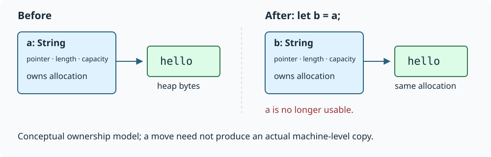

# Rust for a C, Python, and TypeScript programmer

**A 15–20 minute introduction.** You already know how to program; this guide concentrates on what changes when you program in Rust. Examples use stable Rust and the 2024 edition. Deliberately rejected examples are marked `compile_fail`; most other snippets illustrate individual items rather than complete programs.

## 1. The central bargain

Think of Rust as C-level control with a much stronger static contract. There is no required garbage collector, objects do not all live on the heap, and ordinary function calls need no interpreter. You choose representation, allocation, sharing, and indirection—but the compiler checks many obligations that C leaves to your discipline.

The important shift is not syntax. It is making **ownership and access permissions part of your program's types and structure**.

In C, a pointer rarely tells you whether you may free its target, retain it, mutate it, or use it concurrently. Rust distinguishes these cases. Safe Rust prevents dangling references, double frees, and data races. It does **not** promise freedom from memory leaks, deadlocks, incorrect algorithms, or panics. Those guarantees also depend on any underlying `unsafe` code honoring its contracts.

Three familiar-language analogies help, up to a point:

- **C:** values, explicit layouts when requested, native compilation, predictable allocation. Unlike C, a normal reference comes with validity and aliasing requirements the compiler enforces.
- **Python:** expressive collections and iteration, but no pervasive dynamic typing or implicit shared ownership of objects.
- **TypeScript:** inference, generics, and discriminated unions, but Rust's types constrain actual runtime representation and access, not just a type-checking layer over JavaScript.

The new question to ask constantly is: **who owns this value, and who currently has permission to access it?**

## 2. Enough syntax and tooling to get started

Install the toolchain with [rustup](https://rustup.rs/). Cargo handles builds, dependency resolution, tests, and packaging:

```sh
cargo new rust-tour --edition 2024
cd rust-tour
cargo run                 # debug build, then execute
cargo run --release       # optimized build
cargo check               # type/borrow checking without producing an executable
cargo test
cargo fmt
cargo clippy              # additional linting; install the component if needed
```

`Cargo.toml` is the package manifest; `Cargo.lock` records resolved dependencies. A *crate* is a compilation unit: usually a library or executable. A package can contain both. Dependencies are crates too; you normally add them with `cargo add NAME`.

An **edition** opts a crate into a set of language changes; it is not the compiler's version. Crates using different editions can interoperate.

Here is the basic shape:

```rust
fn classify(n: i32) -> &'static str {
    let magnitude = n.unsigned_abs();
    if magnitude < 10 { "small" } else { "large" }
}

fn main() {
    let count = 3;             // immutable binding; type inferred
    let mut total: i64 = 0;    // mutable binding; explicit type
    for n in 0..count {        // half-open range
        total += n as i64;
    }
    println!("{total}: {}", classify(count));
}
```

Key differences from C:

- Blocks and `if` are **expressions**. A final expression without a semicolon supplies the block's value. Adding a semicolon generally changes that result to `()`, the unit type.
- Function parameter and return types are explicit; local types are usually inferred.
- `i32`, `u64`, `f64`, etc. have explicit widths. `usize` is the unsigned pointer-sized integer used for indexing.
- Numeric conversions are not generally implicit. `as` can truncate or reinterpret numeric values; use checked conversions such as `u8::try_from(n)` when failure matters.
- `println!`, `vec!`, and `format!` are macros, hence `!`. Rust macros operate on syntax; they are not C-style textual substitution.
- There are no exceptions to declare or catch as part of ordinary error handling. More on that below.

`mut` belongs to a binding. It is not a universal promise that nothing reachable through an immutable binding can change: types with *interior mutability* deliberately provide controlled exceptions.

### Project structure is not textual inclusion

`src/main.rs` is the usual executable root; `src/lib.rs` is the library root. Modules organize a crate's namespace. For example, `mod parser;` normally loads a child module from `parser.rs` or `parser/mod.rs`, relative to the declaring source file's module location. `use crate::parser::parse;` brings a path into scope; it does not include source text or execute a Python-style import.

Items are private by default. `pub` exposes them, subject to their enclosing modules' visibility; `pub(crate)` exposes them only inside the current crate. Struct fields have their own visibility, so a public struct can keep its representation private.

## 3. Ownership: assignment can consume a value

An owning value is responsible for its resources. When it is dropped, cleanup runs. For example, a `String` owns a growable UTF-8 buffer; a `Vec<T>` owns a contiguous buffer of elements.

```rust
let a = String::from("hello");
let b = a;                     // ownership moves to b
// println!("{a}");            // error: a was moved
println!("{b}");
```



The move does not duplicate the string's bytes. Conceptually, it transfers the small owning handle and makes the old binding unusable. The compiler may optimize away any physical handle copy.

This is very different from Python's `b = a`, where two names usually reference the same object. It is also different from copying a C struct containing an owning pointer, where both copies remain usable and you must prevent double-free yourself.

The same rule applies at function boundaries:

```rust
fn consume(text: String) {
    println!("{text}");
} // text is dropped here

let message = String::from("hello");
consume(message);
// message is no longer usable
```

Returning a value transfers ownership to the caller. Moving a resource into a struct transfers responsibility to that struct. **Moves are the default, not special syntax.**

### Copy versus Clone

Some types implement `Copy`: integers, booleans, and other types that permit implicit duplication. For them, assignment leaves the original usable:

```rust
let x = 42;
let y = x;
println!("{x} {y}");
```

`String` and `Vec<T>` are not `Copy`. To duplicate a string's owned buffer, ask explicitly:

```rust
let a = String::from("hello");
let b = a.clone();
```

`Clone` does not universally mean “deep-copy everything.” Its meaning belongs to the type: cloning a `String` duplicates its buffer; cloning an `Rc<T>` creates another shared owner of the same allocation. `Copy` types are also `Clone`.

### Destruction, not manual free

Rust calls `Drop` implementations automatically when values are dropped. Collections also drop their elements. This handles memory, files, lock guards, and other resources. You do not normally write `free`, and cleanup does not wait for a garbage collector.

You can release something early with `drop(value)`, which consumes it. But do not use destruction as a reliable way to report fallible operations: explicitly flush or commit when failure matters. Aborting a process also bypasses normal cleanup.

**C instinct to replace:** instead of documenting “caller must free,” express ownership in the parameter and return types.

## 4. Borrowing: access without taking ownership

Most functions should not consume their inputs. They borrow them:

```rust
fn byte_length(text: &str) -> usize {
    text.len()
}

fn add_suffix(text: &mut String) {
    text.push('!');
}

let mut message = String::from("hello");
let length = byte_length(&message);
add_suffix(&mut message);
println!("{message}: originally {length} bytes");
```

`&T` is a **shared reference**. `&mut T` is an **exclusive reference**, normally used to mutate. Both are non-owning and must point to valid data; neither is nullable.

The working rule is:

> For overlapping access to the same memory, allow shared references or an exclusive reference—not conflicting uses of both.

Through `&T`, ordinary data cannot be mutated. Through `&mut T`, you have exclusive access to the borrowed data, including protection from competing reads. Ownership remains elsewhere in both cases.

Why this restriction? Consider retaining a reference into a vector while growing it:

```compile_fail
let mut values = vec![10, 20, 30];
let first = &values[0];
values.push(40);             // could reallocate, invalidating first
println!("{first}");         // so this program is rejected
```

C would let you manufacture a use-after-free. Rust rejects it before execution.

Borrows usually end at their **last use**, not at the closing brace:

```rust
let mut values = vec![10, 20, 30];
let first = &values[0];
println!("{first}");         // last use of first
values.push(40);             // now allowed
```

The checker tracks more than “one mutable reference in the entire program.” It can distinguish separate struct fields, and APIs such as `slice.split_at_mut(i)` safely produce two nonoverlapping mutable slices. When you know two runtime indices are distinct, the compiler may still need such an API to establish that fact.

Borrowing also explains a useful loop distinction:

```rust
let mut values = vec![1, 2, 3];
for x in &values { println!("{x}"); } // borrow elements as &i32
for x in &mut values { *x += 1; }     // borrow elements as &mut i32
for x in values { println!("{x}"); }  // consume vector, yielding elements
// values has been moved
```

The same syntax can borrow, mutate, or consume depending on the iterator source. Read the types, not just the punctuation.

## 5. Lifetimes: relationships, not manual memory management

A lifetime describes how long a borrow can validly be used. The compiler infers most of them:

```rust
fn first_word(text: &str) -> &str {
    text.split_whitespace().next().unwrap_or("")
}
```

This returns a view into the input, not a new string. The signature's elision rules connect the returned reference to the input reference. The caller cannot keep using the result after the backing data becomes invalid.

With multiple inputs, an explicit relationship may be necessary:

```rust
fn longer<'a>(a: &'a str, b: &'a str) -> &'a str {
    if a.len() >= b.len() { a } else { b }
}
```

Read this as: “for a shared borrow lifetime `'a`, accept two string slices valid for that lifetime and return one valid for it.” The result cannot be used beyond the lifetime available from both inputs. The function does not promise which input it selects.

**Annotations do not extend an object's life.** They cannot make returning a reference to a local `String` legal. Return an owned `String` in that case.

A struct can hold a borrow:

```rust
struct Token<'a> {
    text: &'a str,
    offset: usize,
}
```

This represents a token whose text is backed by something else. It avoids copying, but makes the backing storage's lifetime a concern for users of `Token`. An owned `String` field is often a better initial design.

`&'static str`, the type of a string literal, can refer to data valid for the entire program. A `T: 'static` bound means `T` contains no borrows that limit it to a shorter lifetime—not that a value of `T` must remain alive forever. An owned `String` satisfies that bound and can still be dropped immediately.

**When fighting the borrow checker:** first simplify ownership. Choose one owner, shorten a borrow, return owned data, or separate mutation from inspection. Do not start by adding lifetime annotations everywhere.

## 6. Model data with structs, enums, and exhaustive matches

Structs are straightforward; methods live in `impl` blocks:

```rust
#[derive(Debug)]
struct Point {
    x: f64,
    y: f64,
}

impl Point {
    fn norm(&self) -> f64 {
        self.x.hypot(self.y)
    }

    fn translate(&mut self, dx: f64, dy: f64) {
        self.x += dx;
        self.y += dy;
    }
}
```

A method's receiver advertises its access: `self` consumes, `&self` borrows, `&mut self` borrows exclusively. `Point::new(...)`, when provided, is an ordinary associated function, not a special constructor mechanism. `derive` generates implementations for supported traits.

Rust enums are tagged unions whose variants may carry different data:

```rust
enum Event {
    Quit,
    Key(char),
    Resize { width: u32, height: u32 },
}

fn describe(event: Event) -> String {
    match event {
        Event::Quit => String::from("quit"),
        Event::Key(c) => format!("key {c}"),
        Event::Resize { width, height } => format!("{width}×{height}"),
    }
}
```

Think TypeScript discriminated unions, but with a concrete native representation and exhaustive checking. Adding a variant forces relevant matches to be reconsidered, unless a wildcard arm already accepts it.

Two standard enums replace common C conventions:

```rust
enum Option<T> { None, Some(T) }
enum Result<T, E> { Ok(T), Err(E) }
```

These definitions illustrate types already provided by the standard library. `Option<T>` represents absence instead of a nullable ordinary reference; `Result<T, E>` represents an operation's success or failure. A `Some(0)` is distinct from `None`.

Use `if let Some(value) = maybe_value { ... }` when you only care about one pattern. Patterns can move contained values too: matching `&event` rather than `event` borrows its contents instead of consuming them.

There is no class inheritance. Prefer structs composed from other structs, enums for a closed set of alternatives, and traits for shared capabilities.

## 7. Errors are values; panics are a different mechanism

A fallible function normally returns `Result`:

```rust
use std::num::ParseIntError;

fn doubled(text: &str) -> Result<i32, ParseIntError> {
    let n = text.parse::<i32>()?;
    Ok(n.saturating_mul(2))
}
```

Here `?` means: extract the `Ok` value, or return early with the error, converting it through `From` when needed. It is explicit propagation, not an exception thrown through arbitrary callers. The containing function must have a compatible return type. `?` also propagates `None` inside an `Option`-returning function; it does not automatically turn an `Option` into a `Result`.

The `::<i32>` spelling supplies a generic type argument at a call site; it is often nicknamed the *turbofish*.

Useful combinators:

- `map`: transform a success/present value.
- `map_err`: transform an error.
- `and_then`: chain another fallible operation.
- `ok_or_else`: turn absence into a lazily constructed error.
- `unwrap_or_else`: supply a fallback by running a closure.

`unwrap()` and `expect("reason")` panic on `None` or `Err`. They are reasonable in tests and for genuinely established invariants, but are not a substitute for handling malformed input.

A **panic** signals an unrecoverable condition for that execution path. With unwinding enabled, stack unwinding runs destructors; an aborting configuration terminates directly. Catching panics is not the normal application error model, and panics must not unwind across an incompatible C ABI boundary.

Libraries often define a precise error enum. Applications often use an error wrapper such as `Box<dyn std::error::Error>` or a crate like `anyhow`. Those choices trade explicit error structure against convenient propagation; they do not change what `Result` means.

## 8. Traits and generics: capabilities without inheritance

A trait specifies behavior that types can implement:

```rust
trait Measure {
    fn measure(&self) -> usize;
}

impl Measure for String {
    fn measure(&self) -> usize {
        self.len()
    }
}

fn twice<T: Measure>(value: &T) -> usize {
    value.measure() * 2
}
```

`T: Measure` is a constraint checked at compile time. Generic code is usually *monomorphized*: the compiler generates specialized code for concrete types. There need not be a virtual call or allocation.

Contrast these signatures:

```rust
fn static_size(value: &impl Measure) -> usize { value.measure() }
fn dynamic_size(value: &dyn Measure) -> usize { value.measure() }
```

The first is essentially a generic parameter with a trait bound; the second uses a **trait object**, accessed through a data pointer and vtable. Dynamic dispatch does not itself require heap allocation: `&dyn Measure` borrows, while `Box<dyn Measure>` owns a heap-allocated value. Not every trait supports trait objects.

In a return position, `impl Trait` means one concrete implementation type hidden from the caller, not any implementation selected at runtime. Different branches cannot return unrelated concrete types merely because both implement that trait.

Common traits explain much of the standard library:

| Trait | Meaning |
|---|---|
| `Debug` / `Display` | Diagnostic formatting (`{:?}`) / intended textual formatting (`{}`) |
| `Clone` / `Copy` | Explicit duplication / implicit copy semantics |
| `Default` | A conventional default value |
| `PartialEq`, `Eq`, `PartialOrd`, `Ord` | Equality and ordering, with differing guarantees |
| `Iterator` | A source of successive values |
| `From` / `TryFrom` | Infallible / fallible conversions |
| `Drop` | Cleanup when a value is destroyed |

Traits can declare **associated types**. `Iterator`, for example, has `type Item` and a `next(&mut self) -> Option<Self::Item>` method. This associates an element type with an iterator implementation.

Unlike TypeScript interfaces, trait implementations are explicit, not structurally inferred. Coherence rules also generally prevent you from implementing a foreign trait for a foreign type. Wrap it in your own one-field struct—the *newtype* pattern—when you need local behavior.

## 9. Strings, slices, collections, and iteration

The everyday vocabulary:

| Type | Owns storage? | Purpose |
|---|---|---|
| `String` | Yes | Growable UTF-8 text |
| `&str` | No | Borrowed UTF-8 view |
| `Vec<T>` | Yes | Growable contiguous sequence |
| `&[T]` / `&mut [T]` | No | Shared / exclusive slice |
| `[T; N]` | Contains elements inline | Fixed-length array; length is part of its type |
| `Box<T>` | Yes | Unique ownership of a heap-allocated value |
| `HashMap<K, V>` | Yes | Hash table |

Accept `&str` rather than `&String`, and `&[T]` rather than `&Vec<T>`, unless you need something specific to those owning types. Dereference coercions let callers pass references to the owning types conveniently.

A slice is conceptually a pointer plus a length, not a copy of its elements. A `Vec<T>` is conceptually pointer, length, and capacity; growing past capacity may relocate its buffer. Neither description is a general license to assume a stable C ABI layout.

Arrays do not implicitly decay into pointers as in C. Ordinary array, slice, and vector indexing is bounds-checked and panics on an invalid index; `.get(index)` returns `Option<&T>` instead. Optimizers can eliminate checks they prove unnecessary.

### Text is not a byte-indexed array of characters

`String::len()` counts **bytes**. Rust rejects `text[0]` because the intended operation is ambiguous. Use:

- `.bytes()` for UTF-8 bytes;
- `.chars()` for Unicode scalar values;
- a Unicode segmentation library for user-perceived characters, or *grapheme clusters*.

`&text[a..b]` uses byte offsets and panics unless they are in bounds and on UTF-8 boundaries. `.get(a..b)` returns an `Option<&str>` instead. Arbitrary binary data belongs in `Vec<u8>`; operating-system paths belong in `Path`/`PathBuf`, since they need not be valid UTF-8.

### Iterators are lazy and usually allocation-free until collected

```rust
let values = vec![1, -2, 3];
let squares: Vec<i32> = values
    .iter()
    .copied()
    .filter(|x| *x > 0)
    .map(|x| x * x)
    .collect();
```

`.iter()` yields references; `.copied()` copies `Copy` elements into values. `.collect()` allocates the output vector here. Without a consuming operation such as `collect`, `sum`, or a `for` loop, the pipeline does no traversal.

`.into_iter()` invokes consuming iteration for its receiver: on an owned vector it moves out elements; on a reference it borrows. This distinction matters far more than the method's name alone.

Closures use `|argument| expression` and infer their capture modes from their bodies. `move || ...` captures by value—moving non-`Copy` captures—rather than borrowing the surrounding bindings. That does not automatically make a closure callable only once; what its body does determines that.

## 10. Shared ownership, threads, and async

If one owner is not the right model, choose sharing explicitly:

- `Rc<T>`: reference-counted ownership within one thread.
- `Arc<T>`: atomic reference-counted ownership suitable for sharing across threads when `T` meets the required thread-safety bounds.
- `RefCell<T>`: interior mutability with borrowing rules checked at runtime; conflicting borrows panic, or return errors through `try_borrow` methods.
- `Mutex<T>` / `RwLock<T>`: synchronized interior access, suitable for cross-thread use with appropriate `T`.

`Rc<RefCell<T>>` and `Arc<Mutex<T>>` are common combinations. Neither should be your reflexive translation of every Python object. They add runtime work and can obscure a simpler ownership design. Strong reference cycles can leak; `Weak<T>` provides non-owning links.

Two traits encode important concurrency properties:

- `Send`: ownership can safely transfer to another thread.
- `Sync`: shared references can safely be shared between threads.

These are usually derived automatically from a type's components. `Arc<T>` does not make an otherwise unsafe-to-share `T` magically thread-safe. Ordinary detached-capable `thread::spawn` closures need `'static` captures; scoped threads can instead borrow surrounding data.

Data-race freedom does not imply race-free application logic: lock ordering, atomic protocols, and distributed state remain your responsibility.

`async fn` produces a **future**; calling it does not immediately execute its body. Futures must be polled, normally by an executor. `.await` can suspend the current task instead of blocking its operating-system thread. The standard library defines the core abstractions, but commonly used runtimes such as Tokio are separate dependencies.

Async is not automatic parallelism. Blocking I/O still blocks a runtime worker unless handled appropriately. Holding a synchronous lock guard across `.await` can prevent scheduling progress or make a future unsuitable for spawning. Learn ownership first; async combines those same rules with suspended execution.

## 11. A complete small program

Replace `src/main.rs` in the Cargo project with this. It reads a UTF-8 file containing one integer per nonblank line and prints their sum:

```rust
use std::{env, error::Error, fs, io, process::ExitCode};

fn run() -> Result<(), Box<dyn Error>> {
    let path = env::args_os().nth(1).ok_or_else(|| {
        io::Error::new(io::ErrorKind::InvalidInput, "usage: rust-tour FILE")
    })?;
    let input = fs::read_to_string(path)?;
    let mut total = 0_i64;

    for (index, line) in input.lines().enumerate() {
        let line = line.trim();
        if line.is_empty() {
            continue;
        }
        let value = line.parse::<i64>().map_err(|error| {
            io::Error::new(
                io::ErrorKind::InvalidData,
                format!("line {}: {error}", index + 1),
            )
        })?;
        total = total.checked_add(value).ok_or_else(|| {
            io::Error::new(io::ErrorKind::InvalidData, "sum exceeds i64 range")
        })?;
    }
    println!("{total}");
    Ok(())
}

fn main() -> ExitCode {
    match run() {
        Ok(()) => ExitCode::SUCCESS,
        Err(error) => {
            eprintln!("error: {error}");
            ExitCode::FAILURE
        }
    }
}
```

Notice how the pieces cooperate: `input` owns the text; `lines()` and `trim()` borrow slices from it; parsing produces owned numbers; `?` propagates errors; closures construct contextual errors only when needed. No string cloning or explicit deallocation is required. The whole file is loaded into memory—streaming would be a separate design choice.

`checked_add` makes overflow behavior intentional. Ordinary integer overflow is checked and panics in Cargo's default debug profile; the default release profile disables those checks and wraps. Use checked, saturating, or wrapping methods when that behavior is part of your algorithm rather than relying on build settings.

Tests commonly live alongside the code, in a module compiled only for testing:

```rust
#[cfg(test)]
mod tests {
    #[test]
    fn parses_a_signed_integer() {
        assert_eq!(" -5 ".trim().parse::<i64>(), Ok(-5));
    }
}
```

`cargo test` discovers `#[test]` functions; a panic fails the test. Larger integration tests go under `tests/` and use your library's public API.

## 12. The C escape hatch—and the boundaries to remember

`unsafe` permits specific operations that safe Rust cannot verify, such as dereferencing raw pointers or calling unsafe functions. It is **not** a switch that disables type checking or the borrow checker for an entire block.

The author of unsafe code must establish its safety invariants. Safe callers of a correctly designed wrapper should not have to do so. Rust's standard collections use unsafe internals to expose safe interfaces; the right goal is a small, audited boundary, not zero unsafe code anywhere in the dependency graph.

For C interoperability, use an appropriate `extern "C"` interface, C-compatible field types and representations such as `#[repr(C)]` structs, and an explicit ownership contract. Rust's ordinary `String`, references, and default-layout structs are not a portable C API. Raw pointers can be null or dangling; turning one into a reference requires satisfying the reference's validity and aliasing rules. Allocations must be released through a compatible allocator and ownership protocol.

One last distinction: Rust references are not merely “C pointers with syntax sugar.” Their stronger guarantees are exactly what make safe code safe—and what unsafe code must never violate.

## Where to go next

Use this decision checklist while writing your first program:

1. **Need to retain the value?** Own it: `String`, `Vec<T>`, or your own struct.
2. **Only need to inspect it?** Borrow it: `&T`, `&str`, `&[T]`.
3. **Need to modify it temporarily?** Borrow exclusively: `&mut T`.
4. **Can it be absent or fail?** Model that with `Option` or `Result`.
5. **Need multiple owners?** Decide whether reference counting is truly necessary, and whether the sharing crosses threads.

Then build a small CLI with a parser and tests. Resist cloning merely to silence the compiler until you understand which ownership relationship caused the error; once understood, a deliberate clone can be the best engineering choice.

For deeper study:

- [The Rust Programming Language](https://doc.rust-lang.org/book/): the main tutorial, especially [ownership](https://doc.rust-lang.org/book/ch04-00-understanding-ownership.html), [lifetimes](https://doc.rust-lang.org/book/ch10-03-lifetime-syntax.html), and [error handling](https://doc.rust-lang.org/book/ch09-00-error-handling.html).
- [Rust by Example](https://doc.rust-lang.org/rust-by-example/): runnable, focused examples.
- [Standard library documentation](https://doc.rust-lang.org/std/): read method signatures; they describe ownership and failure behavior unusually well.
- [The Edition Guide](https://doc.rust-lang.org/edition-guide/): what editions change, and what they do not.

**The main idea:** Rust does not ask you to forget C's memory model. It asks you to state—and let the compiler check—the ownership and access discipline you previously had to maintain yourself.
