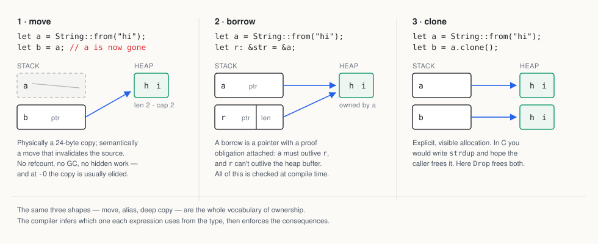
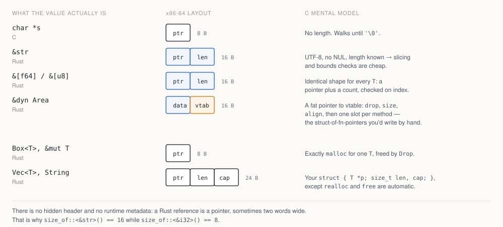
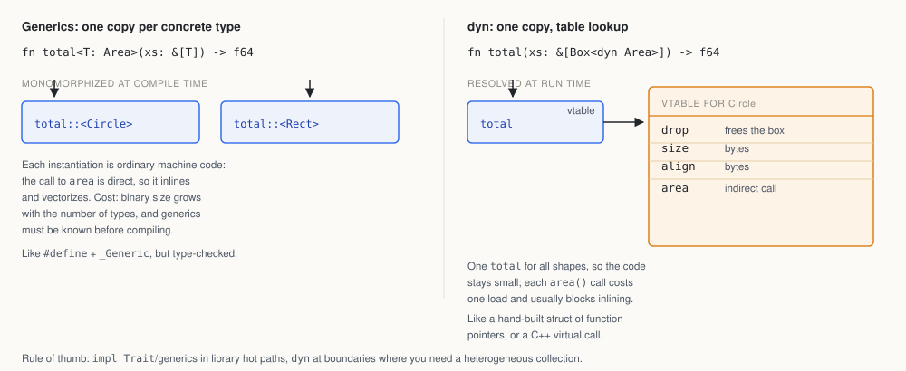

# Rust, for people who already know C

*For working programmers. Assumes you can read a pointer, a dict, and a discriminated union without
help. Everything below is stable Rust as of late 2026 (rustc 1.99, edition 2024).*

Rust is C's machine model with a type system that tracks **who owns what**. Same stack frames, same
heap, same cache behaviour, same `malloc` underneath. The difference is that pointers carry a
compile-time proof of validity, and the proof is checked before your program ever runs.

That's the whole trick. Everything else — traits, `Result`, `async` — is ordinary language design
that happens to fit around it.

If you already write C, you will find that Rust is mostly *familiar things made checkable*: `&mut T`
is `restrict` that the compiler enforces, `Drop` is `goto cleanup` that cannot be forgotten, `match`
is a `switch` that must cover every case, `Result` is `errno` as a return value, and slices are
arrays that remember their length. The unfamiliar part is that these guarantees are threaded through
the type system, so two thirds of the work moves from runtime debugging to compile errors.

**Contents** · [The five ideas](#the-five-ideas) · [Setup](#setup-in-ninety-seconds) ·
[First program](#first-program-and-whats-hiding-in-it) · [Ownership](#ownership) ·
[Borrowing](#borrowing-and-what-the-checker-is-actually-doing) ·
[Slices and strings](#slices-strings-and-what-a-reference-physically-is) ·
[Enums and errors](#enums-option-result-and-match) · [Traits](#traits-generics-and-the-two-kinds-of-dispatch) ·
[Memory](#memory-management-in-practice) · [Concurrency](#concurrency) · [FFI](#unsafe-ffi-and-talking-to-c) ·
[Cargo](#cargo-crates-and-the-parts-of-the-ecosystem-you-need) · [Annoyances](#what-will-annoy-you) ·
[Cheat sheet](#translation-table) · [Learning path](#how-to-actually-learn-it)

---

## The five ideas

1. **Values have one owner.** When it goes out of scope, the value is freed, deterministically, by
   calling its destructor (`Drop`). No GC, no refcounting by default.
2. **You can borrow instead of moving.** `&T` is a shared borrow, `&mut T` is an exclusive one.
   Many shared *or* one exclusive, never both. The compiler uses this to prove pointers stay valid.
3. **Enums are tagged unions, and `match` is exhaustive.** `Option<T>` replaces null, `Result<T, E>`
   replaces errno and exceptions.
4. **Traits are nominal interfaces**, checked at compile time, dispatched either statically
   (monomorphised generics, like C++ templates but type-checked) or dynamically (a fat pointer with a
   vtable, like the hand-rolled struct-of-function-pointers you've written in C).
5. **`unsafe` is an explicit, local escape hatch** for raw pointers and FFI — not a mode you turn on
   for the whole program.

There is no inheritance, no implicit conversions, no null, no exceptions, no overloaded `=`, and — in
safe code — no runtime type errors. The language is smaller than C++ and stricter than C.

---

## Setup in ninety seconds

```bash
curl --proto '=https' --tlsv1.2 -sSf https://sh.rustup.rs | sh
cargo new words && cd words
cargo run
```

`cargo` is make, pkg-config, dependency manager, test runner, doc builder and linter driver. A project
is a directory with `Cargo.toml` (manifest), `src/main.rs` or `src/lib.rs`, and a `Cargo.lock` for
binaries. There are no header files, no forward declarations, no build script to maintain: a crate is
compiled as one unit from its `src/lib.rs` downward, dependencies are compiled separately and cached,
and `cargo build` drives the linker for you.

| You type | You get |
|---|---|
| `cargo check` | type-check only; typically 2–5× faster than a full build — run it constantly |
| `cargo build --release` | optimised binary in `target/release/` |
| `cargo test` | unit tests, integration tests, and **doc tests** (code in `///` comments) |
| `cargo doc --open` | HTML docs for your crate and every dependency |
| `cargo clippy` | hundreds of lints, many of them about idiom, not just bugs |
| `cargo fmt` | gofmt-style formatting, non-negotiable in practice |
| `cargo add serde --features derive` | edit `Cargo.toml` and pick a version |

Modules replace headers: `mod parser;` looks for `src/parser.rs`, `pub` marks what escapes the
module, and `use` imports paths. Tests live next to the code in `#[cfg(test)] mod tests`, and every
`///` example in your docs is compiled and executed by `cargo test` — which is why the standard
library's examples can be trusted.

Install `rust-analyzer` (via your editor) and you get type-on-hover, go-to-definition across crates,
and inlay hints showing inferred types and lifetimes. It is the single biggest quality-of-life
difference from C tooling.

---

## First program, and what's hiding in it

```rust
use std::collections::HashMap;

fn main() {
    let text = "the quick brown fox jumps over the lazy dog the end";
    let mut counts: HashMap<&str, u32> = HashMap::new();

    for word in text.split_whitespace() {
        *counts.entry(word).or_insert(0) += 1;
    }

    let mut pairs: Vec<_> = counts.into_iter().collect();
    pairs.sort_by_key(|&(_, n)| std::cmp::Reverse(n));

    for (word, n) in pairs.iter().take(3) {
        println!("{word:>8} {n:>3}");
    }
}
```

Line by line, for a C reader:

- `let` declares; `mut` opts into mutation. Bindings are immutable by default — the opposite default
  from C, and it eliminates a class of "who changed this?" bugs.
- `"..."` is a `&'static str` pointing into the binary's rodata. No allocation.
- `HashMap<&str, u32>` borrows its keys from `text`; nothing is copied. Python's `Counter` is this
  in one line, but here you can see who owns the memory.
- `entry(word).or_insert(0)` is the C idiom `if (!(p = find(k))) { p = insert(k, 0); } *p += 1;`
  expressed so that the "insert if missing" path can't be forgotten.
- `Vec<_>` — the `_` means "infer this"; `collect()` is generic over its target container, and the
  annotation picks `Vec<(&str, u32)>` for you.
- `sort_by_key` takes a **closure** — a function pointer plus captured environment. C's `qsort`
  needs a `void*` and a comparator; here the compiler generates a specialised comparator and inlines
  it.
- `dbg!(x)` prints the expression, its value, file and line, then hands the value back, so it drops
  into the middle of an expression. Closest thing to a printf you can leave in.
- `println!` is a macro, not a function: it checks the format string at compile time. `{word:>8}`
  pulls in a local variable, with alignment; `{:?}` prints any `#[derive(Debug)]` type.

The syntax details that trip up C programmers: a block is an **expression** (`let x = if c { 1 } else { 2 };`
is legal), semicolons matter (`{ 1 }` yields `1`, `{ 1; }` yields `()`), and `if` conditions must be
`bool` — no `if (ptr)`. That last rule alone kills a whole family of bugs.

---

## Ownership

Every value has exactly one owner. Assignment moves; leaving scope drops.

```rust
let s = String::from("hello");   // s owns a heap buffer
let t = s;                       // ownership moves to t
println!("{s}");                 // error[E0382]: borrow of moved value: `s`
```

```text
error[E0382]: borrow of moved value: `s`
  |
2 |     let s = String::from("hello");
  |         - move occurs because `s` has type `String`,
  |           which does not implement the `Copy` trait
3 |     let t = s;
  |             - value moved here
4 |     println!("{s}");
  |                ^ value borrowed here after move
```



Physically this is a 24-byte header copy; semantically the source is dead. At `-O` the copy usually
disappears. Types that are "plain old bits" — integers, floats, `bool`, `char`, arrays of them, and
structs you mark `#[derive(Clone, Copy)]` — are `Copy`, so they behave exactly like C values and can
be used after assignment. Everything owning a resource (`String`, `Vec`, `Box`, `File`, sockets) is
move-only. This is the same distinction C++ makes with copy constructors, but derived automatically
from whether the type has a destructor.

Three consequences worth internalising:

- **Destruction is deterministic and ordered.** Values drop in reverse declaration order at the end of
  the enclosing block, including on early return and on panic. That is `goto cleanup` for free, and it
  is why Rust code has no `goto out:` ladder.
- **Passing by value can be cheap or expensive, and the type tells you which.** `fn f(v: Vec<u8>)`
  takes ownership and does not copy the buffer. `fn f(v: &[u8])` borrows. There is no hidden deep
  copy, ever, unless you call `.clone()`.
- **The compiler elides most moves.** Returning a `Vec` from a function is not a copy; it is the same
  buffer, moved through registers (and often constructed in place).

When you need two references to the same value, you either borrow temporarily or reach for shared
ownership (`Rc`/`Arc`, below). When you need an *optional* value, you use `Option<T>` — and because
`Box<T>`, `&T`, `Vec<T>` and `String` all have a non-null niche, `Option<Box<T>>` and `Option<&T>`
are still 8 bytes. No null pointer, no size cost.

---

## Borrowing, and what the checker is actually doing

```rust
fn total(xs: &[f64]) -> f64 { xs.iter().sum() }

fn main() {
    let mut v = vec![1, 2, 3];
    let first = &v[0];
    v.push(4);            // error[E0502]: cannot borrow `v` as mutable ...
    println!("{first}");
}
```

The rule is *many readers XOR one writer*. It is the rule you already follow informally in C — you
don't `realloc` a buffer while holding a pointer into it — except the compiler enforces it and the
error appears at the exact line where the aliasing starts.

The checker is a **liveness/dataflow analysis over the control-flow graph**, not a scope-based rule
and definitely not a runtime mechanism. A borrow ends at its last use (non-lexical lifetimes), so this
is fine:

```rust
let mut v = vec![1, 2, 3];
let first = &v[0];
println!("{first}");
v.push(4);                 // ok: the borrow is already dead
```

**Lifetimes** are the names for those inferred regions. You only write them when inference is
ambiguous — typically in structs that hold references, or functions with several reference
parameters and a reference return:

```rust
struct Parser<'a> { input: &'a str, pos: usize }

fn longest<'a>(a: &'a str, b: &'a str) -> &'a str {
    if a.len() >= b.len() { a } else { b }
}
```

`'a` compiles to nothing. It is a proof obligation, not a runtime object, which is why "lifetimes are
hard" is really "the compiler is asking you to specify an invariant you were previously keeping in
your head". Most application code writes zero lifetimes; `&str` in, `String` out, and the elision
rules do the rest. In structs, holding owned data (`String`, `Vec`) rather than references removes
the parameters entirely — the standard advice is: **start owned, borrow at the edges**.

`&mut T` deserves a note: it is a *unique* pointer, so the compiler can hand LLVM `noalias` metadata
for it exactly as C's `restrict` promises. This is one reason Rust often matches or beats tuned C on
loop-heavy code: aliasing information is guaranteed rather than promised by convention.

Three idioms that resolve most borrow-checker friction:

```rust
let mut v = vec![1, 2, 3, 4];
let (left, right) = v.split_at_mut(2);   // two disjoint &mut into one Vec
for x in &mut v { *x *= 2; }              // exclusive borrow, one element at a time
v.retain(|x| *x > 0);                     // mutate/remove without holding indices
```

And the structural fix: if you need to mutate a graph or tree while traversing it, don't hold `&mut`
across the traversal. Store nodes in a `Vec` and link them by `u32` index. It is exactly the layout
you'd choose in C for cache reasons, and it sidesteps the borrow checker for the same reason.

---

## Slices, strings, and what a reference physically is



A Rust reference is one or two machine words and no metadata beyond that:

- `&T` / `&mut T` / `Box<T>` — one pointer.
- `&[T]` / `&str` — pointer plus length (a *fat pointer*), 16 bytes.
- `&dyn Trait` — pointer plus vtable pointer, 16 bytes.
- `Vec<T>` / `String` — pointer, length, capacity, 24 bytes.

The middle two are the important ones. A slice is your `(T*, size_t)` pair promoted to a first-class
value with bounds checks on indexing and no separate length argument to get wrong. `&Vec<T>`
coerces to `&[T]`; write your functions to take `&[T]` and they'll accept arrays, vectors, and
sub-slices.

Strings are UTF-8, not NUL-terminated, and **not indexable by integer**:

```rust
let s = "héllo";            // 6 bytes, 5 chars
assert_eq!(s.len(), 6);     // bytes
assert_eq!(s.chars().count(), 5);
// s[1] would panic: byte 1 is not a char boundary
for c in s.chars() { /* ... */ }
```

`String` is the growable owned type; `&str` is the borrowed view. The convention that makes APIs
pleasant: take `&str`, return `String`. For C interop you convert explicitly — `CString` adds the
NUL, `CStr` borrows one, and both check for interior NULs. For filesystem paths use `Path`/`PathBuf`
rather than strings; on Unix a path is bytes, not UTF-8, and Rust models that correctly.

---

## Enums, `Option`, `Result`, and `match`

```rust
#[derive(Debug, Clone, Copy)]
enum Shape {
    Circle { r: f64 },
    Rect { w: f64, h: f64 },
}

impl Shape {
    fn area(&self) -> f64 {
        match *self {
            Shape::Circle { r } => std::f64::consts::PI * r * r,
            Shape::Rect { w, h } => w * h,
        }
    }
}
```

An enum is a tagged union whose discriminant is sized by the compiler, with no invalid states
representable. `match` destructures it and must be exhaustive — adding a variant breaks every
non-wildcard match at compile time, which is the closest thing to a free refactor you'll get in a
statically typed language. Guards, ranges, and nesting all work:

```rust
match (code, retries) {
    (200, _) => Ok(body),
    (500..=599, n) if n < 3 => retry(),
    (401 | 403, _) => Err(Auth),
    (c, _) => Err(Unexpected(c)),
}
```

`Option<T>` and `Result<T, E>` are ordinary enums in `std`, not compiler magic. There are no
exceptions and no `errno`; a function that can fail says so in its type, and `?` propagates:

```rust
fn port(s: Option<&str>) -> Result<u16, ConfigError> {
    let raw = s.ok_or(ConfigError::Missing("port"))?;  // Option -> Result
    Ok(raw.parse()?)     // ParseIntError -> ConfigError, via impl From<_>
}
```

`?` is early-return plus `From::from` on the error, so `?` also performs error-type conversion —
which is why that snippet needs `impl From<ParseIntError> for ConfigError` somewhere, and why
libraries define one error enum per module and let `?` do the plumbing. In application
code, `anyhow::Result<T>` boxes any error; in library code, `thiserror` generates the enum and the
`From` impls from `#[from]`. `Box<dyn Error>` is the lowest-common-denominator type when you don't care. Binary entry points can
return `Result` too, so `fn main() -> anyhow::Result<()>` and a bare `?` is the standard shape for a
CLI.

Two things C programmers ask immediately:

- **`unwrap()` is not "ignore the error".** It panics — abort the thread, run destructors, print a
  message. Use it for bugs and prototypes, `expect("...")` when the message should say what invariant
  broke. In a server, a panic in one task doesn't take down the process by default.
- **Panics are not exceptions.** They are for broken invariants, not control flow. They unwind by
  default (`panic = "abort"` in your profile turns that off, which also makes binaries smaller), and
  they cross an FFI boundary only over `extern "C-unwind"`.

`if let`, `let ... else`, and (edition 2024) `let` chains keep this readable:

```rust
if let Some(user) = lookup(id) && user.active && let Ok(n) = user.age.parse::<u8>() {
    println!("{n}");
}

let Some(cfg) = load() else { return Err(ConfigError::Missing("config")) };
```

---

## Traits, generics, and the two kinds of dispatch



A trait is a set of methods a type can implement. It is *nominal*: the impl is written explicitly,
unlike TypeScript's structural types or Go's interfaces, which means the set of behaviours a type has
is a closed, searchable list — and the compiler can warn about a missing one.

```rust
trait Area {
    fn area(&self) -> f64;

    fn describe(&self) -> String {              // default method
        format!("{:.2} square units", self.area())
    }
}

impl Area for Shape { fn area(&self) -> f64 { /* as above */ } }
```

Generic functions are monomorphised: one copy of the machine code per concrete type, so calls
inline and the abstraction costs nothing:

```rust
fn total<T: Area>(items: &[T]) -> f64 {
    items.iter().map(|x| x.area()).sum()
}

total(&vec![Shape::Circle { r: 1.0 }]);   // total::<Shape>, fully inlined
```

`dyn Trait` is the other choice: one copy of the function, a vtable lookup per call, and the ability
to hold heterogeneous values:

```rust
fn total_dyn(items: &[Box<dyn Area>]) -> f64 {
    items.iter().map(|x| x.area()).sum()
}

let shapes: Vec<Box<dyn Area>> = vec![
    Box::new(Shape::Circle { r: 1.0 }),
    Box::new(Shape::Rect { w: 2.0, h: 3.0 }),
];
```

A realistic signature, decoded:

```rust
fn load(path: impl AsRef<Path>) -> Result<Config, ConfigError>
```

`impl AsRef<Path>` is an anonymous generic — "anything that can be viewed as a path" (`&str`,
`String`, `PathBuf`), monomorphised per caller. `Result<Config, ConfigError>` says it can fail and
with what. That's most of what Rust signatures ever say: one constraint per argument, one honest
return type. There are no hidden exceptions and no hidden allocation.

Rules of thumb: generics for library internals and hot paths, `dyn` at boundaries, when you need
runtime extensibility (plugins, test doubles), or when monomorphisation would blow up compile time and
binary size. `impl Trait` in argument position is sugar for a generic; in return position it means "a
concrete type I'm not naming" (an opaque type), which is how `async fn` works under the hood.

The trait machinery you'll actually use daily:

| Trait | Means | Derivable? |
|---|---|---|
| `Debug` | `{:?}` formatting | yes |
| `Clone` / `Copy` | explicit deep copy / implicit bit copy | yes |
| `PartialEq`, `Eq`, `Hash`, `Ord` | comparison, hashing, sorting | yes |
| `Default` | zero-ish value | yes |
| `Display` | `{}` formatting | no, write it |
| `From` / `Into`, `TryFrom` | infallible / fallible conversions | no |
| `Iterator` | `for` loop protocol, adapters | no, implement `next` |
| `Deref` | smart-pointer coercion (`&String` → `&str`) | no |
| `Serialize` / `Deserialize` | JSON, TOML, bincode via serde | yes |

Two constraints surprise people. **Coherence/orphan rule:** you can implement a trait for a type only
if the trait or the type is local to your crate. That prevents two dependencies from adding
conflicting impls, and it's why you see the *newtype* pattern (`struct Meters(f64);`) to attach
foreign traits to foreign types. **No inheritance:** share behaviour by composing and by using
supertraits (`trait Shape: Area + Debug`), not by subclassing. There is no `virtual`, no `override`,
no fragile base class problem.

If you're coming from TypeScript: think of traits as interfaces that are *checked*, not erased.
There is no `any`, no `as` escape from the type system, and no runtime shape checks — a
"compile-time-only" abstraction is genuinely free, and a wrong assumption is a compile error, not a
`undefined` at 3 a.m.

---

## Memory management in practice

You will not call `malloc` or `free`. You will choose a container, and the container's `Drop` does
the rest:

| You want | Use | Cost model |
|---|---|---|
| One heap value | `Box<T>` | `malloc`/`free` |
| Growable array | `Vec<T>` | amortised doubling, like a C dynamic array |
| Owned text | `String` | same, UTF-8 validated on insert |
| Shared, read-only | `Rc<T>` / `Arc<T>` | refcount; `Arc` is atomic |
| Shared, mutable | `Rc<RefCell<T>>` / `Arc<Mutex<T>>` | runtime borrow check (panics) / lock |
| Optional global | `OnceLock<T>` / `LazyLock<T>` | once-init, then a load |
| Maybe-owned string | `Cow<'a, str>` | borrow until you must allocate |

`RefCell<T>` is worth understanding: it moves the borrow rules to runtime. `borrow()` and
`borrow_mut()` return guards, and violating the aliasing rule panics instead of failing to compile.
It's the right tool for caches, observer lists, and graphs — and, like `Rc`, it is single-threaded,
which the compiler enforces because `Rc<T>` is not `Send`.

For tree/graph-shaped data, the idiom that scales is arenas plus indices (`Vec<Node>`, `u32` links),
or a crate like `bumpalo` or `typed-arena`. That is exactly the C approach — contiguous storage,
integer handles — with the added benefit that the borrow checker stops complaining because there are
no long-lived pointers.

`Drop` is the destructor trait. It runs on scope exit, on `?`, on `break`, and on unwind. You
implement it for resource handles (file descriptors, locks, GPU buffers) to get RAII; you almost never
implement it for plain data. `std::mem::forget` and `ManuallyDrop` let you leak deliberately; the one way `Rc`
leaks by accident is a reference cycle. Allocators are pluggable per binary via
`#[global_allocator]` — jemalloc, mimalloc, and a custom arena all work.

---

## Concurrency

The ownership rules generalise to threads with two marker traits:

- `Send` — the value can move to another thread.
- `Sync` — `&T` can be shared across threads.

They are auto-derived structurally, and `!Send` types (`Rc`, `RefCell`, raw pointers) are rejected at
the spawn call. Data races are therefore a compile error, not a code review item. Locks and channels
are ordinary library types:

```rust
use std::sync::{Arc, Mutex};

let counter = Arc::new(Mutex::new(0u64));
let mut handles = Vec::new();
for _ in 0..8 {
    let c = Arc::clone(&counter);
    handles.push(std::thread::spawn(move || {
        for _ in 0..1000 { *c.lock().unwrap() += 1; }
    }));
}
for h in handles { h.join().unwrap(); }
```

If you don't need `'static` threads, `std::thread::scope` lets spawned threads borrow from the stack —
no `Arc` required. For data parallelism, `rayon` turns `iter()` into `par_iter()` and gives you
work-stealing without changing the algorithm. Message passing is `std::sync::mpsc` (or `crossbeam` /
`flume` for more features). Atomics are `std::sync::atomic`, with explicit `Ordering`.

**Async** is the part where Rust is still visibly a work in progress. An `async fn` compiles to a
function returning a state machine implementing `Future`; nothing runs until an executor polls it.
The standard library defines the trait but ships no runtime, so you pick one — `tokio` for I/O,
`smol` for a smaller stack, `embassy` for embedded. Consequences:

- `#[tokio::main]` is a macro that builds a runtime and blocks on your future.
- Futures are lazy; `let f = fetch();` does nothing until `.await`.
- `tokio::spawn` requires `Send + 'static`; borrow across tasks needs scoped tasks or `Arc`.
- A blocking call inside a task stalls a worker thread; use `spawn_blocking`.
- `Pin` exists because the generated state machines are self-referential. You meet it in signatures,
  rarely in code.

Async closures are stable (1.85) and `async fn` in traits has been stable since 1.75, but async
methods are not yet usable through `dyn Trait` — that's a 2026–2027 goal, along with async drop and
scoped spawning. In practice: use async for I/O-bound servers, threads for CPU-bound work, and
`rayon` for data parallelism. Don't mix them casually. If you need both, `tokio::task::spawn_blocking`
is the seam.

---

## `unsafe`, FFI, and talking to C

`unsafe` unlocks five things: dereferencing raw pointers, calling `unsafe` functions, accessing
`static mut`, implementing `unsafe` traits, and reading `union` fields. It does **not** disable the
borrow checker, and it does not mean "trust me" — it means "I have checked these specific
preconditions", which you should write down:

```rust
/// # Safety
/// `p` must be valid for reads of `len` bytes and not aliased for the duration.
unsafe fn checksum(p: *const u8, len: usize) -> u32 {
    let mut sum = 0u32;
    for i in 0..len {
        // SAFETY: caller guarantees p is valid for len bytes.
        sum = sum.wrapping_add(unsafe { *p.add(i) } as u32);
    }
    sum
}
```

The C boundary is designed to be boring:

```rust
#[repr(C)]
pub struct Point { pub x: f64, pub y: f64 }

#[unsafe(no_mangle)]                       // edition 2024 spelling
pub extern "C" fn distance(a: Point, b: Point) -> f64 {
    ((a.x - b.x).powi(2) + (a.y - b.y).powi(2)).sqrt()
}

unsafe extern "C" { fn abs(i: i32) -> i32; }
```

`#[repr(C)]` fixes the layout, `extern "C"` fixes the calling convention, `#[unsafe(no_mangle)]`
fixes the symbol name. From there: `bindgen` generates Rust bindings from C headers; `cbindgen`
generates a C header from Rust; `cxx` does the C++ equivalent. `cargo build --crate-type=cdylib`
(or `staticlib`) produces a `.so`/`.a` you can link from a C build system.

Worth knowing: since Rust 1.99 you can *define* C-variadic functions natively (`unsafe extern "C" fn f(n: u32, args: ...)`
with `VaList::next_arg`), which used to require a shim. And `no_std` lets you drop the standard
library for kernels and microcontrollers, keeping `core` (no allocator) or `alloc`.

Two structural facts about the ecosystem: **Rust has no stable ABI**, so crates are distributed as
source and compiled together (that's why generics and `#[inline]` can be so aggressive); and the
stable interface between Rust and everything else is the C ABI. Plan your FFI boundary around plain
`#[repr(C)]` structs and `extern "C"` functions, not around Rust types.

---

## Cargo, crates, and the parts of the ecosystem you need

A **package** is `Cargo.toml`; a **crate** is a compilation unit (one library or binary); a
**workspace** is several packages sharing a lockfile and `target/`.

```toml
[package]
name = "words"
version = "0.1.0"
edition = "2024"

[dependencies]
serde = { version = "1", features = ["derive"] }
anyhow = "1"

[profile.release]
lto = "thin"
codegen-units = 1
```

**Features are additive** — enabling a feature must never disable behaviour, because any crate in the
graph can turn it on. That's why you see `default-features = false` and why "negative features" are
considered a design smell.

Editions (2015, 2018, 2021, 2024) are opt-in language revisions per crate. They let the language fix
defaults — `async`/`await` keywords, disjoint closure captures, `unsafe extern`, `gen` reserved for
generators — without breaking old code, and without splitting the ecosystem the way Python 2/3 did.

The crates you will meet in the first week: `serde` (+ `serde_json`) for serialisation, `anyhow` and
`thiserror` for errors, `clap` for CLIs, `tokio` for async, `reqwest` for HTTP, `rayon` for
parallelism, `itertools`, `regex`, `tracing` for structured logs, `proptest` for property tests,
`criterion` for benchmarks, `insta` for snapshot tests. Async alternatives exist but tokio is the
default choice; pick it unless you have a reason not to.

Your existing debugging tools still work: `gdb`/`lldb` understand Rust symbols, `perf` and
`cargo flamegraph` profile it, `rr` records it, and `RUST_BACKTRACE=1` turns a panic into a stack
trace. What changes is how rarely you need them — most of what you'd run valgrind to find
(use-after-free, uninitialised reads, buffer overruns) is a compile error here.

Tooling worth installing on day one: `cargo-nextest` (faster, better test output), `cargo-expand`
(see what macros generated), `cargo-tree`, `cargo-audit` or `cargo-deny` (supply chain — the
ecosystem has had real attacks), and `miri` (an interpreter that finds undefined behaviour in
`unsafe` code, including out-of-bounds and aliasing violations). Link with `lld` or `mold` if link
times annoy you; `lld` has been the default on Linux x86-64 since 1.90. Rust links its own
dependencies statically and libc dynamically by default; target `x86_64-unknown-linux-musl` if you
want a single fully static binary, which is common for container images.

---

## What will annoy you

Honest list, because the marketing isn't.

**Compile times.** A clean build of a mid-sized dependency tree is minutes, and monomorphisation
makes it worse. `cargo check` and incremental builds mitigate it; nothing makes it as fast as Go.
Template-heavy Rust is the slowest.

**Borrow-checker friction, at first.** You will write code that is obviously correct and be told it
isn't, because the checker reasons per-path and per-alias, not per-intention. The fix is almost never
"add `clone()`" (though that's the fast fix); it's restructuring — pass slices, split borrows, use
indices, shorten the borrow's live range. After a few weeks the errors become predictable, and you
start designing data structures the checker likes.

**`Pin`, `Send` bounds, and async diagnostics.** The error messages in async code are the worst in the
language: a missing `Send` surfaces as a wall of "future is not `Send`" with the real cause several
layers down. `cargo expand` shows you the generated state machine; patience helps more.

**Verbose conversions.** `u8` to `usize` is `as`, but `i64` to `u32` is `try_into()?`, and `as`
silently truncates — the exact bug C has. Rust makes the safe path easy to write, not invisible. And
integer overflow panics in debug builds but wraps in release, so a test that passes with `cargo test`
can still be wrong in production.

**Dyn-compatibility rules.** Not every trait can become `dyn Trait` (no generic methods, no
`Self`-returning functions). The compiler tells you precisely why, but it's a concept you have to
learn.

**Ecosystem gaps.** GUI, scientific computing, and some FFI-heavy domains are less mature than C++ or
Python. Async has visible seams. `unsafe` crates vary in quality; read the `SAFETY` comments.

**No stable ABI.** Distributing a Rust library to non-Rust consumers means C ABI, which means manual
marshalling. Plugin systems are still awkward.

**The type system can't express everything.** Self-referential structs, doubly-linked lists, and
mutable graphs need arenas, indices, or `unsafe`. This is not a bug — those structures are hard in C
too — but Rust makes you say so.

And the other side of the ledger, which is why people stay: no use-after-free, no double-free, no
data races, no null dereferences, no iterator invalidation, no forgotten `free` on the error path, no
"works on my machine because of an uninitialised variable", and a compiler that turns "did I handle
this case?" into a build failure.

---

## Translation table

| C | Rust |
|---|---|
| `T *p = malloc(n * sizeof *p)` | `let mut v: Vec<T> = Vec::with_capacity(n);` |
| `free(p)` | drop at scope end; `drop(v)` to force it |
| `char *s` + `strlen` | `&str` (ptr + len) |
| `strdup` | `s.to_string()` |
| `T *arr, size_t n` as parameters | `&[T]` / `&mut [T]` |
| `struct` passed by value | same layout; non-`Copy` structs move instead of copying |
| `switch` + `default` | `match`, exhaustive, with destructuring |
| `union` + tag | `enum` with payloads |
| `errno`, `-1` return | `Result<T, E>` and `?` |
| `goto cleanup` | `Drop` implementations |
| `restrict` | `&mut T` (guaranteed unique) |
| `NULL` | `Option<T>` (same size when `T` is a pointer) |
| function pointer + `void *ctx` | closure (fn ptr + captured env) |
| `qsort(a, n, sizeof *a, cmp)` | `a.sort_by(cmp)` |
| `#define MAX(a,b)` | `fn max<T: Ord>(a: T, b: T) -> T` or a `macro_rules!` |
| `#ifdef DEBUG` | `cfg!(debug_assertions)`, `#[cfg(...)]` |
| `assert` | `assert!`, `debug_assert!` |
| `printf("%d\n", x)` | `println!("{x}")`; `format!` to build a `String` |
| `volatile T *` | `AtomicT` (with an `Ordering`), or `read_volatile` |
| `memcpy` | `Copy` assignment, `clone_from_slice` |
| `sizeof(T)` | `size_of::<T>()`, `align_of::<T>()` |
| inline header files | none — modules and `pub` |
| `Makefile` + pkg-config | `Cargo.toml` |

---

## How to actually learn it

Read *The Rust Programming Language* (the Book) — chapters 4 (ownership), 6 (enums), 10 (generics,
traits, lifetimes) and 13 (iterators/closures) carry most of the weight. Then do Rustlings, which is
~90 small exercises with instant compiler feedback; it is the fastest way to convert C intuitions into
Rust ones. Keep the standard library docs open — they are unusually good, and every page has examples
that run.

Then build something real, with dependencies: a CLI with `clap`, reading JSON with `serde`, errors
with `anyhow`, and a `.await` somewhere. Port a small C utility and notice where the code gets
shorter (resource handling, parsing, string manipulation) and where it gets longer (borrowing across
data structures, generic bounds).

Three habits that pay off:

1. **Write `cargo check`-driven.** Let the compiler drive; fix the first error, not all of them.
2. **Clone first, optimise later.** `clone()` is a correctness-preserving escape hatch. Measure
   before removing it — often the profiler says it doesn't matter.
3. **Learn to read `rustc --explain E0xxx`.** The error index is a tutorial keyed to your exact
   mistake, and the compiler's suggested fixes are usually right.

Rust's real cost is a few weeks of unlearning: you stop thinking "who frees this?" and start thinking
"who owns this, and for how long?" Once that question is automatic, the language gets out of the way —
and the class of bugs you used to debug at 2 a.m. simply stops existing.
