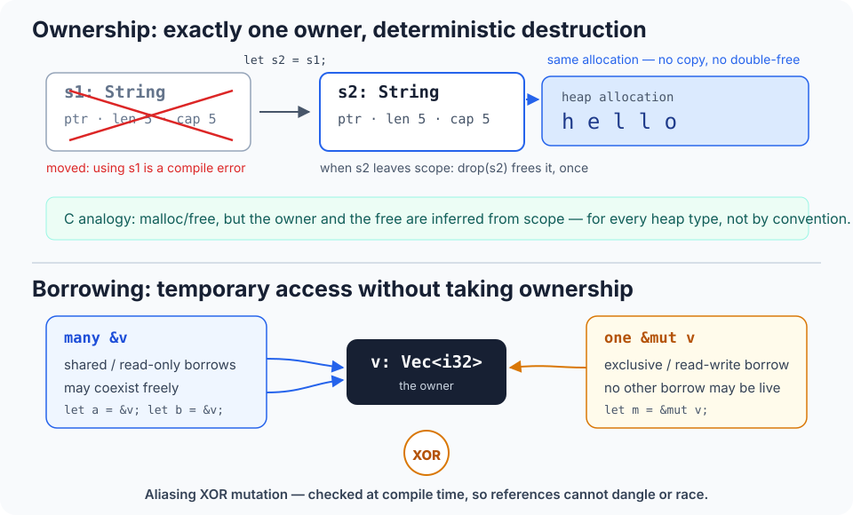
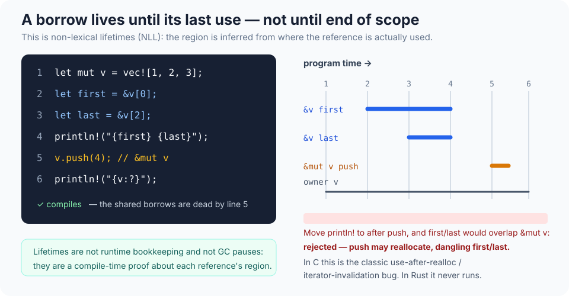
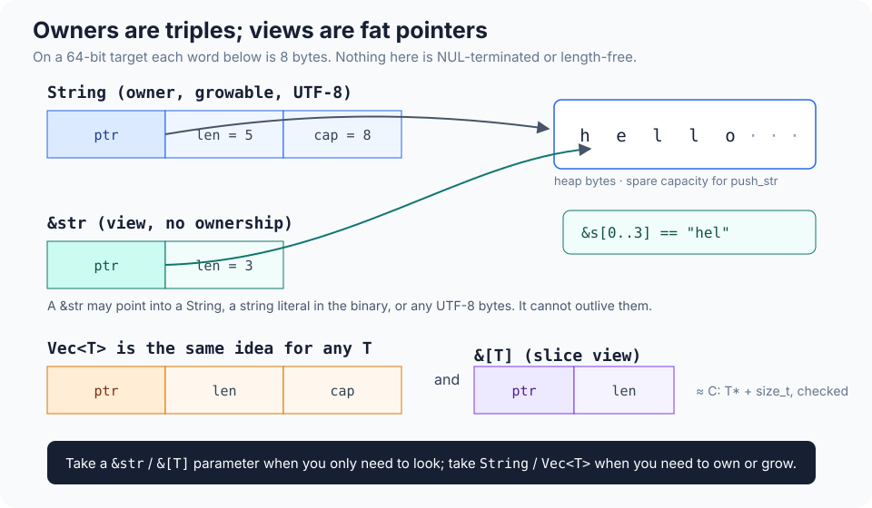

# Rust for People Who Already Know C, Python, and TypeScript

*An 18-minute introduction. Nothing here assumes C++; several ideas will look familiar from it anyway, and those are flagged when they appear.*

You already have three useful mental models:

- **C:** values have a size and an address, memory is yours to mismanage, and the compiler mostly trusts you.
- **Python:** objects live on the heap behind references, a garbage collector cleans up, and almost anything can fail at runtime with an exception.
- **TypeScript:** a rich static type system — generics, unions, narrowing — that is erased before execution and therefore promises nothing at runtime.

Rust is best understood as an attempt to keep C's model — explicit layout, stack allocation, no garbage collector, compile to native code — while making the compiler *prove* the things C leaves to discipline, and to give that proof a type system closer in spirit to TypeScript's than to C's. The price is that the compiler will reject programs you know are "probably fine", and you will spend your first weeks arguing with it. This document is about what it is proving, why, and how to stop arguing.

One sentence version: **every value has exactly one owner; you may lend it out under strict rules; the compiler verifies statically that no loan outlives the value or overlaps a writer.** Almost everything distinctive about Rust follows from that.

---

## 1. Where Rust sits

| | C | Python | TypeScript | Rust |
|---|---|---|---|---|
| Execution | native, AOT | interpreter + GC | erased types, JS runtime | native, AOT |
| Memory freed by | you (`free`) | GC | GC (in JS) | owner going out of scope |
| Null | `NULL`, unchecked | `None`, checked at runtime | `null`/`undefined`, checked statically* | no null; `Option<T>` |
| Errors | return codes, `errno` | exceptions | exceptions / promises | `Result<T, E>` values (+ panics for bugs) |
| Data races | possible | mostly prevented by the GIL, conceptually possible | possible in workers | **compile error** |
| Use-after-free / double-free | possible | impossible | impossible | **compile error** |
| Runtime cost of safety | — | high | — | ~zero (checks are static) |

\* until someone writes `as any`, or a `.d.ts` file lies.

Two clarifications. First, "no runtime" means no GC, no interpreter, no object header, no hidden allocation: a Rust binary has a small runtime in the C sense (stack setup, panic machinery) but nothing that inspects your heap. It can run with no OS (`no_std`: kernels, firmware, bootloaders) and its binaries look, to a debugger, much like C binaries. Second, "safe" has a precise meaning: in code not marked `unsafe`, Rust guarantees no use-after-free, no double-free, no null or uninitialised dereference, no data races, and no out-of-bounds access (bounds checks *are* runtime, and panic rather than corrupt memory). Logic bugs, deadlocks, memory leaks, and panics remain entirely possible.

The toolchain is unusually unified, which will feel luxurious coming from C and familiar-but-better coming from Python/TS:

```console
$ curl --proto '=https' --tlsv1.2 -sSf https://sh.rustup.rs | sh   # or your package manager
$ cargo new hello && cd hello
$ cargo run        # build + run        $ cargo test     # run #[test] functions
$ cargo clippy     # a very opinionated linter   $ cargo fmt   # the one true formatter
```

`cargo` is simultaneously `make`, `pip`/`npm`, a test runner, a doc generator (`cargo doc` produces genuinely good HTML from doc-comments), and a dependency solver with a lockfile. Libraries ("crates") come from crates.io, are compiled from source into your binary, and are versioned with semver that cargo actually enforces. There are no header files and no include paths: a crate is a module tree, `pub` marks what's exported, and `use std::collections::HashMap;` is an import, not a textual inclusion.

**Editions** are Rust's answer to evolving without breaking the world: 2015, 2018, 2021, 2024. An edition is chosen per-crate in `Cargo.toml`, the compiler supports all of them forever, and crates of different editions link together freely. Examples here use edition 2024. Rust releases every six weeks and "stable" is a hard promise: code that compiles today compiles in ten years, minus rare, loudly-announced soundness fixes.

---

## 2. The core: ownership

Forget garbage collection and forget `malloc`/`free` pairing. In Rust, **each value has one owner** — a variable, a struct field, a slot in a vector. When the owner goes out of scope, the value is *dropped*: its destructor runs and its resources (heap memory, file handles, sockets, locks) are released, deterministically, exactly there. If you know C++'s RAII, it is that, but applied to *every* type with no opt-out, so it needs no prior C++ knowledge to use: scope exit = cleanup, as if the compiler inserted the right `free`/`fclose`/`close` for you, in reverse order of construction.

Assignment and argument-passing **move** non-trivial values instead of copying them:

```rust
let s1 = String::from("hello");   // s1 owns a heap buffer
let s2 = s1;                      // ownership MOVES to s2; the buffer is not copied
println!("{s1}");                 // ✗ compile error: use of moved value
```



This is the single biggest surprise for a C programmer: `s2 = s1` looks like a struct copy (and in C it would be a shallow `memcpy` — the classic double-free setup), but in Rust it is a transfer after which the source is statically dead. For a Python/TS programmer: assignment does not create a second reference to a shared object; it hands the object over. If you genuinely want a copy, say so: `s1.clone()` performs the deep copy, visibly, at a cost you can see in the code. Small plain-data types — integers, floats, `bool`, `char`, and tuples/arrays of them — are marked `Copy` and do copy silently, exactly as in C, because copying them is free and they own nothing.

Functions participate in the same system. Passing a `String` by value gives it away; taking `&String` borrows it; returning a value moves ownership to the caller. There is no third, implicit mode.

### Borrowing

A **reference** is a borrow: access without ownership, and without the right to free anything.

- `&T` — a shared reference. Read-only, and any number may exist simultaneously. Think `const T*`, except the compiler proves the pointee outlives the pointer.
- `&mut T` — an exclusive reference. Read-write, and while it exists, *no other reference to that value may be used*. Think `T*`, plus a uniqueness guarantee no C compiler gives you.

The rule is often stated as **aliasing XOR mutation**: data is either shared or mutable, never both, at any instant. This is not an optimisation hint (though LLVM exploits it heavily, which is part of why Rust is fast). It is what kills whole bug classes:

- **Use-after-free / dangling pointers** — a reference cannot outlive its owner (§3).
- **Iterator invalidation** — `v.push(x)` needs `&mut v`; if you hold `&v[0]` across it, that's a shared borrow overlapping a mutable one: compile error. The segfault you have debugged in C, and the `RuntimeError: dictionary changed size` you have caught in Python, become a build failure with a helpful message.
- **Data races** — two threads can only race if one can mutate while another accesses; the XOR rule, extended across threads (§7), forbids exactly that.

Mutation being a *type-level* property is worth pausing on. C's `const` is shallow and castable; TS's `readonly` is shallow and erasable. In Rust, `&T` vs `&mut T` is as fundamental a distinction as `i32` vs `String`, it is transitive (a `&` to a struct gives you `&`s to its fields, never `&mut`), and there is no `const_cast`. Separately, *bindings* are immutable by default: `let x = 5;` cannot be reassigned unless you write `let mut x = 5;`. Immutability-by-default plus move semantics will feel familiar from functional programming; it is there to make the borrow checker's job — and the reader's — tractable.

When shared mutation is genuinely the design (a cache behind a read API, a graph), Rust offers *interior mutability*: `Cell`, `RefCell`, `Mutex`, `RwLock`. These move the XOR check to runtime — `RefCell` will panic if you break the rule dynamically, much like a Python error — and their presence in a type is visible in its signature. They are the marked escape valves, not the norm.



### Lifetimes: the part everyone fears, mostly unnecessarily

If references can never outlive their owner, someone must check "never outlives". That check is **lifetime analysis**, and the scary-looking `'a` annotations are simply names for the regions being compared — in function signatures, where the compiler cannot infer them. You write them rarely, because of *elision*: in the common cases (one input reference, or `&self`) the output clearly borrows from one source and the compiler fills it in.

Read this signature the way you'd read a contract:

```rust
fn longest<'a>(x: &'a str, y: &'a str) -> &'a str
```

"Given two string views that both live at least as long as some region `'a`, I return a view that lives no longer than `'a`." That is all a lifetime ever says. Lifetimes are erased at compile time: they cost nothing, allocate nothing, and appear nowhere in the binary. The C translation is "this returns a pointer into one of its arguments, not into a local or a fresh allocation" — a fact C forces you to document in a comment and Rust forces the caller and callee to agree on, mechanically. Returning a pointer to a local, the C bug, is rejected: the local's region ends at the closing brace and the return type demands a longer one.

---

## 3. The language, at speed

You can skim this section; everything is chosen for contrast with what you know.

**Syntax and basics.** C-flavoured braces and semicolons, but statements are expressions: `if`, `match`, and bare blocks return values, and a function's return value is its last expression without `return` (early `return` still exists). Type inference is strong but local: `let v = vec![1, 2, 3];` needs no annotation, but function signatures are fully annotated — inference never crosses a function boundary, which keeps APIs honest and error messages local. There is a fixed menu of integer types (`i8`…`i128`, `u8`…`u128`, `isize`/`usize`, `f32`/`f64`) and **no implicit numeric conversions at all**: `i32 + i64` is an error, `as` casts are explicit, and integer overflow panics in debug builds and wraps (with explicit `wrapping_add` etc. when that's what you mean) in release. `char` is a 4-byte Unicode scalar value, not a byte. Variables may be *shadowed* (`let x = x.trim();`), which is idiomatic for transformation pipelines.

**Structs, enums, and pattern matching.** Structs are plain data with named or tuple fields; methods live in separate `impl` blocks; there is no inheritance, at all, ever (§4). Enums are algebraic data types — TS discriminated unions, but native and exhaustively checked:

```rust
enum IpAddr {
    V4(u8, u8, u8, u8),
    V6(String),
}

let home = IpAddr::V4(127, 0, 0, 1);
match home {
    IpAddr::V4(127, _, _, _) => println!("loopback"),
    IpAddr::V4(a, b, c, d)   => println!("{a}.{b}.{c}.{d}"),
    IpAddr::V6(s)            => println!("[{s}]"),
}
```

`match` must cover every case (the compiler lists the ones you missed), binds the payload while checking the variant — no TS-style "narrowing was lost inside the closure" — and is an expression. The two enums you will use hourly are in the standard library and replace two of your languages' warts:

- `Option<T>` — `Some(x)` or `None`. There is **no null** in Rust. A function that might not find something returns `Option`; the type system forces you to handle `None` before touching the value. No `NullPointerException`, no `Cannot read properties of undefined`, no segfault, unless you explicitly `.unwrap()` and accept a panic as your handling.
- `Result<T, E>` — `Ok(x)` or `Err(e)`, for anything fallible. See §5.

**Strings will hurt briefly, then make sense.** Rust strings are guaranteed UTF-8, and there are two types: `String` (owned, growable, heap — the `Vec<u8>`-with-a-UTF-8-invariant) and `&str` (a borrowed view: pointer + length, pointing into a `String`, a literal baked into the binary, or a buffer you own). Because UTF-8 is variable-width, `s[0]` is deliberately not a thing: indexing by byte could split a character, so you write `s.as_bytes()[0]`, `s.chars().next()`, or slice on a char boundary — the API makes the O(n) or byte-level nature of what you asked for explicit. Take `&str` parameters, return `String` when creating text: exactly the owned/view split C programmers hand-roll with `char*` plus conventions, and Python hides by making everything an immutable heap object.



The same owned/view split generalises: `Vec<T>` owns, `&[T]` is a slice (fat pointer: address + element count, always bounds-checked), `PathBuf`/`&Path`, `OsString`/`&OsStr` for the platform strings that aren't valid UTF-8. In C terms: Rust took `T* + size_t`, made it one indivisible value, and checks it. Arrays `[T; N]` have their length in the type and live wherever you put them, stack included. `HashMap<K, V>`, `BTreeMap`, `HashSet`, `VecDeque` are in `std`, generic, and unsurprising; `.get()` returns `Option<&V>`, because of course it does.

**Closures and iterators.** Closures look like `|x| x + 1` and capture by the weakest means that works (borrow, mutable borrow, or move). Iterators are lazy and adapter-based — `map`, `filter`, `fold`, `zip`, `enumerate`, `take`, `collect` — much closer to Python generator pipelines than to TS array methods, except that they compile down to loops with no allocation or virtual dispatch: this is the "zero-cost abstraction" slogan made concrete. `for x in &collection` borrows, `for x in collection` consumes it; the difference is in the types, visible at the call site.

**Macros** exist (`println!`, `vec!`, `format!`) and are hygienic and AST-based, nothing like the C preprocessor: they cannot leak identifiers or unbalance your parentheses, and `!` marks them at the call site. You will use standard ones daily and write your own rarely.

---

## 4. Traits: interfaces, done as a type system

A **trait** is a set of methods a type can promise to provide — the closest things in your languages are a TS `interface` or a Python protocol/`abc`, with two differences that matter: implementation is explicit and separate from the type definition, and dispatch is usually static.

```rust
trait Summary {
    fn summarise(&self) -> String;
    fn teaser(&self) -> String { self.summarise().chars().take(20).collect() }  // default method
}

impl Summary for Article {
    fn summarise(&self) -> String { format!("{} — {}", self.headline, self.author) }
}
```

Generics are constrained by traits (`fn print_all<T: Summary>(items: &[T])`, sugar: `impl Summary` in argument position) and are **monomorphised**: the compiler stamps out a specialised copy per concrete type, checks the generic body *once, at its definition*, against the declared bounds, and produces code as fast as hand-written C for each type. If that sounds like C++ templates, it is — except the definition-site checking means errors point at your generic function, not at a 200-line instantiation backtrace, and you do not need to know C++ to use any of it. Dynamic dispatch is opt-in and explicit: `Box<dyn Summary>` is a fat pointer (data + vtable) for when you genuinely need a heterogeneous collection or a smaller binary.

Things to internalise:

- **`#[derive(...)]`** generates the boring impls — `Debug` (the `{:?}` format), `Clone`, `PartialEq`, `Hash`, `Copy`, `Default` — structurally, in one line above the type. Half of Rust's convenience lives here.
- **Standard traits are vocabulary.** `Display` (user-facing `to_string`), `Debug` (developer-facing), `Iterator`, `From`/`Into` (infallible conversions), `AsRef`/`Borrow` (cheap view conversions), `Drop` (the destructor), `Send`/`Sync` (§7). Learning Rust is substantially learning what these names promise.
- **Operator overloading** is trait implementation (`Add`, `Index`, `Deref`…), deliberately restricted to that menu; there is no overloading by arity, no getters/setters magic, and field access is just field access.
- **The orphan rule:** you may implement *your* trait for anyone's type, or *anyone's* trait for your type, but not a foreign trait for a foreign type. This "coherence" guarantees that two crates can never produce conflicting implementations of the same thing — the diamond-dependency nightmare from Python monkey-patching and C++ overload resolution, designed out. The cost: occasionally you must wrap a foreign type in your own one-field struct (a *newtype*) to implement something on it. Do it; newtypes are also how you get the type system to distinguish a `UserId` from a `SessionId`, both wrapping `u64`, for free at runtime.
- **No inheritance.** Reuse is by composition and traits; shared behaviour is a default method or a free function. If you arrive wanting class hierarchies, expect a brief mourning period and then relief.

---

## 5. Errors: values, not exceptions

Fallible functions return `Result<T, E>`. Handling is explicit, and the `?` operator makes explicit not mean verbose:

```rust
use std::{fs, io};

fn load_config(path: &str) -> Result<Config, io::Error> {
    let text = fs::read_to_string(path)?;   // on Err: return it, converted, now
    let cfg  = parse(&text)?;               // same: propagate or bind the Ok value
    Ok(cfg)
}
```

`?` is early-return with error-type conversion (via the `From` trait), so a function reads as the success path with failure exits at the exact points of failure — the shape of good C with `goto cleanup`, or of Python with exceptions, but with the failure channel in the signature where callers must acknowledge it. There is no stack-unwinding exception to forget to catch; equally, there is no way to "just let it bubble" without writing `?` or naming a type. Errors are ordinary enums you define (often with the `thiserror` crate generating boilerplate in libraries) or compose dynamically in applications (the `anyhow` crate's type-erased `Result<T>`). The ecosystem norm: libraries return precise error types; binaries aggregate.

**Panics** are the other channel, and they mean "bug": `unwrap()` on `None`, indexing out of bounds, arithmetic overflow in debug, an assertion. A panic unwinds and drops everything properly (or aborts, if configured); catching one across a library boundary is possible but considered poor form. Rule of thumb matching Python: `Result` for the world being disappointing, panic for your own invariants being violated. Note what is absent: no `try`, no exception hierarchy, no `finally` — scope-based drop *is* `finally`, for every resource, uniformly.

---

## 6. A complete small program

Everything above in one file — ownership, borrows in the signature, an iterator pipeline, `HashMap` with borrowed keys, `Result` with `?`, and not a lifetime annotation in sight (elision infers that the returned words borrow from `text`, and the compiler checks that callers respect it):

```rust
use std::{collections::HashMap, env, error::Error, fs};

fn most_common(text: &str, n: usize) -> Vec<(&str, u32)> {
    let mut counts: HashMap<&str, u32> = HashMap::new();
    for word in text.split_whitespace() {
        let word = word.trim_matches(|c: char| !c.is_alphanumeric());
        if !word.is_empty() {
            *counts.entry(word).or_insert(0) += 1;
        }
    }
    let mut ranked: Vec<(&str, u32)> = counts.into_iter().collect();
    ranked.sort_by(|a, b| b.1.cmp(&a.1).then_with(|| a.0.cmp(b.0)));
    ranked.truncate(n);
    ranked
}

fn main() -> Result<(), Box<dyn Error>> {
    let path = env::args().nth(1).ok_or("usage: wordcount <file>")?;
    let text = fs::read_to_string(path)?;   // an owned String
    for (word, count) in most_common(&text, 10) {   // lent out as &str
        println!("{count:>5}  {word}");
    }
    Ok(())   // text is dropped here; the loop above consumed the borrowed results
}
```

Note the quiet detail: `most_common` returns references *into* a string it does not own. In C this is a loaded gun pointed at whoever frees the buffer first. Here, the (inferred) lifetime ties `ranked` to `text`, so using the results after `text` is dropped is a compile error — the API is safe to offer because the contract is enforced on both sides.

---

## 7. Concurrency: the second payoff

"**Fearless concurrency**" is the marketing phrase; the mechanism is two marker traits. `Send` means a value may move to another thread; `Sync` means it may be shared by reference between threads. Nearly all types are `Send`/`Sync` automatically, by composition. `Rc<T>` — single-threaded reference counting, Rust's opt-in equivalent of Python's everything-is-a-counted-reference, minus the atomicity cost — is deliberately neither, so it cannot leak into a thread by accident. To share ownership across threads you reach for `Arc<T>` (atomic refcount), and to mutate through it, `Arc<Mutex<T>>`; the `Mutex` returns a guard whose `Drop` unlocks, so forgetting to unlock is not expressible, and poisoning (a thread panicked while holding the lock) surfaces as a `Result` rather than silent corruption.

The consequence that matters: **a data race — unsynchronised aliased mutation across threads — is a compile error**, because the borrow rules and `Send`/`Sync` compose. Deadlocks, livelocks, and racing on *logic* (two threads politely locking the same mutex to update two fields inconsistently) remain your problem forever. Channels (`std::sync::mpsc`, and better ones in crates), thread pools (`rayon` makes a parallel iterator literally `.par_iter()`), and scoped threads round out the toolkit. For a C programmer who has shipped a heisenbug in a threaded program, this section alone is frequently the reason to learn the language.

**Async** exists and is heavily used (the `tokio` runtime powers much of the Rust server ecosystem), but be warned it is the least finished-feeling part of the language: `async fn` returns a lazy `Future` (nothing runs until something polls it — closer to a Python generator than to a JS `Promise`, which starts immediately), there is no executor in `std`, and you will meet `Pin` in error messages before you're ready. Learn sync Rust first; async is a second course.

---

## 8. `unsafe`, FFI, and where the floor is

Safety is not mandatory, it is *audited*. Five extra powers are available inside `unsafe { }` blocks: dereferencing raw pointers (`*const T`, `*mut T` — C pointers, with C's rules and C's perils), calling `unsafe` functions, accessing mutable statics, implementing `unsafe` traits, and reading union fields. Crucially, `unsafe` does not switch off the borrow checker, drop, or bounds logic on safe types; it says "*I*, the programmer, uphold the invariants the compiler can no longer check, within this block." The standard library is built this way internally, as is every fast crate; the discipline is that unsafe code is *encapsulated* behind safe APIs whose soundness you argue once — formally, there is even Miri, an interpreter that detects undefined behaviour in unsafe code, something C offers only in much weaker forms (sanitizers). Soundness bugs in an `unsafe` block are bugs in exactly the way C bugs are, which is the point: the unsafe surface is small, greppable, and reviewable, rather than being the entire program.

Interop is first-class because there is no ABI to impose: Rust has no stable native ABI of its own, so at the boundary you use C's. `extern "C" fn`, `#[repr(C)]` structs, `std::ffi::{CString, CStr}` for NUL-terminated strings, and header/`bindgen` tooling to generate bindings from C headers make calling C from Rust routine; exposing a Rust library as a `.so`/`.a` with a C header is equally routine, and is how Rust has quietly colonised pieces of Firefox, the Linux kernel (which now accepts Rust drivers), Windows, Android, and embedded firmware. Add `no_std` support — no allocator required, no `std`, still ownership-checked — and the "systems language" claim is literal, not aspirational.

---

## 9. Honest costs, and when to stay away

- **Compile times.** Monomorphisation, whole-crate optimisation, and no incremental ABI mean clean release builds of large projects are slow — minutes, not the seconds a C programmer is used to. Incremental debug builds and `cargo check` (typecheck only, fast) soften this; big teams still feel it.
- **The borrow checker will reject correct programs.** It checks *a* discipline, not *the truth*; graphs, self-referential structures, and "I mutate through two paths but never simultaneously, trust me" designs fight back. The idiomatic answers — restructure ownership into a tree, use indices into a `Vec` as graph handles (an arena), or take the runtime-checked `Rc<RefCell<T>>` — are real design changes, and sometimes Rust loses: a quick script, a throwaway analysis, a CRUD app on a deadline are all still better in Python or TypeScript, and admitting that is part of using Rust well.
- **Expressiveness friction.** No function overloading, no default arguments, no variadics, verbose generic bounds, and error messages that — while genuinely the best in the business — can run to a page for a misplaced `&`. The learning curve is steepest in weeks 1–4 and is mostly unlearning "share everything" habits from Python/TS and "track it in my head" habits from C.
- **Ecosystem gaps.** GUIs, gamedev tooling, and data-science are years behind Python/JS in breadth (though `serde` for serialisation, the `clap` CLI parser, `reqwest`, `tokio`, `axum`, and `sqlx` are best-in-class where they exist). Expect to find *a* crate; check its maintenance before depending on it.

Rust earns its keep where the failure modes it eliminates are the ones that hurt you: long-lived services, parsers of untrusted input, concurrent infrastructure, anything memory-unsafe in C today, and anything where Python is too slow but rewriting in C feels like malpractice.

---

## 10. Your first week, and what to read next

1. `rustup` in, `cargo new`, and rewrite a small C or Python utility you already understand — the word-counter in §6 is a good template. Reach for `&str`/`&[T]` parameters and owned returns.
2. When the borrow checker complains, read the *whole* error; it usually names the conflicting borrows and suggests the fix. Clone deliberately, note where, and revisit each clone after the program works — most dissolve once ownership is restructured.
3. Force the standard traits early: `#[derive(Debug, Clone, PartialEq)]` on everything, implement `Display` and `From` by hand once, write one generic function with a trait bound and one `Box<dyn Trait>`.
4. Write tests in-file with `#[test]`; run `cargo clippy` and treat it as a patient senior reviewer. It is, effectively, the community's style-and-correctness consensus, executable.
5. Skip async, macros, and clever lifetime gymnastics until a real program demands them.

The canonical next step is *The Rust Programming Language* ("the Book", free at doc.rust-lang.org/book) — chapters 4, 6, 10, and 16 deepen exactly §2, §3, §4, and §7 of this document — with *Rust by Example* for syntax lookup and the `std` docs as a permanent browser tab. You already know how computers work and how type systems feel; what Rust adds is one idea, enforced very thoroughly. Once ownership stops being a rule you obey and becomes the way you sketch designs on a whiteboard, the rest of the language reads as a well-stocked standard library attached to it.

---

### Cheat sheet

| You want | You write | Notes |
|---|---|---|
| Owned heap string / view | `String` / `&str` | UTF-8 always; no byte-indexing into `&str` |
| Growable array / view | `Vec<T>` / `&[T]` | slice = ptr + len, bounds-checked |
| Nullable value | `Option<T>` | `Some`/`None`; `.unwrap()` = "panic if absent" |
| Fallible operation | `Result<T, E>` + `?` | errors are values; `?` converts and returns |
| Copy-like assignment | move, or `.clone()` | `Copy` types (numbers, `bool`) copy silently |
| Read-only / exclusive access | `&T` / `&mut T` | many readers XOR one writer, statically |
| Shared ownership | `Rc<T>` / `Arc<T>` | single- / multi-threaded refcounting |
| Shared mutation | `Cell`/`RefCell`/`Mutex<T>` | XOR rule re-checked at runtime |
| Unique heap value | `Box<T>` | also how you make recursive types sized |
| Interface | `trait` (+ `impl`) | static dispatch; `dyn Trait` for dynamic |
| Destructor / RAII | `Drop` | runs at scope exit; replaces `finally` |
| C pointer | `*const T` / `*mut T` | only dereferenceable inside `unsafe` |
