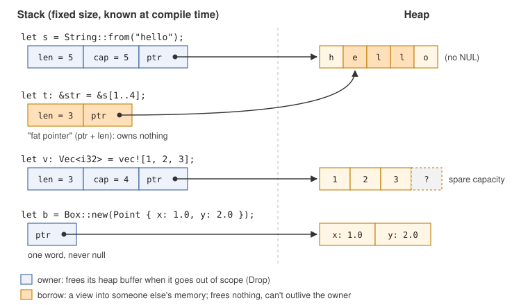
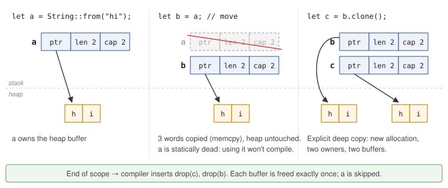
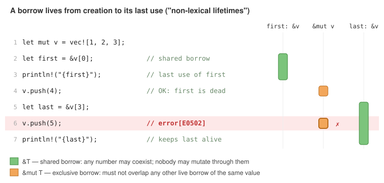

# Rust for People Who Already Know C, Python and TypeScript

*About a 15–20 minute read. It assumes you know what a pointer, a vtable, a closure, a generic and an event loop are, and spends its time on what's actually new.*

---

## The one-paragraph version

Rust is a compiled systems language with no garbage collector and a runtime about the size of C's. You get C's control over memory layout and C-level performance. The type system will feel familiar from TypeScript and ML: sum types, generics, type inference. Unlike TypeScript's, it is sound and is used for code generation. The tooling feels like what Python and JS have been converging on (`uv`, `npm`), only more consistent. What's new is the **ownership and borrowing** discipline. Every heap allocation has exactly one owner, which frees it automatically. Every other pointer is a *borrow*, and the compiler proves at compile time that no borrow outlives what it points to and that nothing is mutated while it is aliased. That one rule rules out use-after-free, double free, iterator invalidation and data races, at zero runtime cost. Most of the rest of the language exists to make that rule comfortable to live with.

If you've used `uv` or `ruff` in Python, or `swc`, Biome or Turbopack in JS, you've already run Rust programs.

---

## 1. Tooling: `cargo` does everything

```bash
curl --proto '=https' --tlsv1.2 -sSf https://sh.rustup.rs | sh   # installs rustup, rustc, cargo
cargo new hello && cd hello
cargo run                 # debug build + run
cargo build --release     # optimized build -> target/release/hello
cargo test                # unit + integration + doc tests
cargo clippy              # linter (very good, use it)
cargo fmt                 # formatter (no style debates)
cargo add serde --features derive   # add a dependency from crates.io
cargo doc --open          # HTML docs for your code and all dependencies
```

`Cargo.toml` is your `package.json` / `pyproject.toml`. `Cargo.lock` pins exact versions. The **edition** field (`edition = "2024"`) selects a language dialect. Crates on different editions link together fine, so editions can fix syntax without splitting the ecosystem. There's no header/include system, no Makefile, and no separate venv or `node_modules` dance. A crate is the compilation unit, the output is usually a single static binary, and cross-compiling is usually just `rustup target add`.

---

## 2. Basics, quickly

```rust
fn main() {
    let x = 5;                 // immutable by default, type inferred (i32)
    let mut count: u64 = 0;    // `mut` opts in to mutation
    count += 1;

    let x = x * 2;             // shadowing: a new binding that reuses the name
    let label = if x > 5 { "big" } else { "small" };   // `if` is an expression

    let total = {              // so is a block: its value is its last expression
        let a = 3;
        a * x                  // no semicolon -> this is the block's value
    };

    for i in 0..3 { println!("{i}"); }          // ranges are half-open
    let squares: Vec<i32> = (1..=5).map(|n| n * n).collect();
    println!("{label} {total} {count} {squares:?}");    // `!` marks a macro
}

fn add(a: i32, b: i32) -> i32 {
    a + b                      // last expression is the return value
}
```

Things that will surprise you:

* **Scalar types are explicit:** `i8…i128`, `u8…u128`, `isize`/`usize` (pointer-sized, used for indexing), `f32`/`f64`, `bool`, and `char` (a 4-byte Unicode scalar value, *not* a byte).
* **There are no implicit numeric conversions.** Even `i32 + i64` is a compile error. Use `as` for C-style casts (which truncate silently) or `u8::try_from(x)?` for checked ones.
* **Overflow** panics in debug builds and wraps in release builds. When you care, say what you mean: `a.wrapping_add(b)`, `a.checked_add(b)` (returns `Option`), `a.saturating_add(b)`.
* **Strings are UTF-8**, and there are two main types: `String` (owned, growable, on the heap) and `&str` (a borrowed view). You can't write `s[3]`, because a byte index into UTF-8 doesn't mean "the third character". Use `s.chars()`, `s.bytes()`, or byte-range slices like `&s[0..3]` (which panic if they split a character).
* **There is no `null`, no `undefined`, no exceptions, no inheritance, no function overloading, and no default arguments.** Each one has a replacement, covered below.

---

## 3. Structs, enums and `match`

### Structs and methods

```rust
#[derive(Debug, Clone, PartialEq)]     // auto-generate printing, copying, ==
struct Point { x: f64, y: f64 }

impl Point {
    fn new(x: f64, y: f64) -> Self { Point { x, y } }   // a convention, not a constructor
    fn norm(&self) -> f64 { (self.x * self.x + self.y * self.y).sqrt() }
    fn scale(&mut self, k: f64) { self.x *= k; self.y *= k; }
}
```

Data and behaviour are declared separately. A `struct` is laid out like a C struct (the compiler may reorder fields unless you write `#[repr(C)]`), and `impl` blocks attach functions to it. The receiver is spelled out: `&self` borrows the value immutably, `&mut self` borrows it mutably, and plain `self` takes ownership (consumes it). This is Python's explicit `self`, with the access mode in the signature.

### Enums are real sum types

In C you write a tagged union and hope everyone checks the tag. In TypeScript you write a discriminated union and the checker helps, as long as nobody lies with `as`. In Rust the tagged union is a language primitive, and the compiler makes sure you check the tag before you can reach the payload:

```rust
enum Shape {
    Circle { r: f64 },
    Rect { w: f64, h: f64 },
    Empty,
}

fn area(s: &Shape) -> f64 {
    match s {                                   // must be exhaustive
        Shape::Circle { r } => std::f64::consts::PI * r * r,
        Shape::Rect { w, h } if w == h => w * w, // guards
        Shape::Rect { w, h } => w * h,
        Shape::Empty => 0.0,
    }
}
```

Add a variant and every `match` that doesn't handle it stops compiling. This is the main reason Rust refactors feel safe.

### `Option` replaces null

`null` is gone. A value that might be absent has type `Option<T>`, which is just an ordinary enum from the standard library:

```rust
enum Option<T> { Some(T), None }     // (already in the prelude, don't define it)
```

```rust
fn find(names: &[&str], target: &str) -> Option<usize> {
    names.iter().position(|n| *n == target)
}

match find(&names, "bob") {
    Some(i) => println!("found at {i}"),
    None => println!("nope"),
}
if let Some(i) = find(&names, "bob") { println!("{i}"); }       // one-armed match
let Some(i) = find(&names, "bob") else { return; };             // early exit
let i = find(&names, "bob").unwrap_or(0);                       // combinators
```

You can't use an `Option<usize>` as a `usize` by accident. A C programmer will want to know the cost: `Option<&T>` and `Option<Box<T>>` are guaranteed to be the same size as a raw pointer, with `None` stored as the null bit pattern. So you get null's representation without null's bugs.

---

## 4. Ownership: the actual new idea

Here are the rules. They're short:

1. Every value has exactly one **owner**, which is a variable, a struct field, a `Vec` slot and so on.
2. When the owner goes out of scope, the value is **dropped**: its destructor runs and its memory is freed. This is deterministic, like C++ RAII or a perfectly reliable `free`.
3. Assignment, passing by value and returning by value **move** ownership. The source becomes unusable.

First, what these types look like in memory. There are no surprises here for a C programmer:



A `String` is a `{ptr, len, cap}` triple pointing at a heap buffer, and a `Vec<T>` is the same thing. A `&str` is a `{ptr, len}` pair pointing into someone else's buffer. A `Box<T>` is a single non-null pointer to a heap allocation. Rust hides none of this, and you can reason about it exactly as you would in C.

Now, what happens on assignment:



```rust
let a = String::from("hi");
let b = a;              // move: copies 3 words, `a` is now dead
// println!("{a}");     // error[E0382]: borrow of moved value: `a`
let c = b.clone();      // explicit deep copy, a second heap buffer
```

Compare the three languages:

* **C:** `b = a` copies the struct. Now two pointers own one buffer, and freeing both is a double free.
* **Python/TS:** `b = a` copies a reference and bumps a refcount, or leaves it to a tracing GC. Now two names alias one mutable object.
* **Rust:** `b = a` copies the struct, and the compiler statically forgets `a`. One owner, one free, no aliasing, no runtime bookkeeping.

Types that are just plain bits with no destructor (integers, floats, `bool`, `char`, `&T`, and tuples or arrays of these) implement the `Copy` trait. Assigning one copies it and leaves the source usable, as in C. A struct you write can opt in with `#[derive(Clone, Copy)]` if all its fields are `Copy`. Anything else needs an explicit `.clone()`, so expensive copies are always visible in the code.

Passing by value moves too:

```rust
fn consume(s: String) { /* s is dropped (freed) at the end of this function */ }

let s = String::from("x");
consume(s);
// s is gone here. Moving ownership in and out of every function
// would be unbearable, which is why borrowing exists.
```

---

## 5. Borrowing: references with rules

A **reference** lets you use a value without taking ownership. There are two kinds:

| | Syntax | How many at once | Can mutate? | Closest analogue |
|---|---|---|---|---|
| Shared borrow | `&T` | any number | no* | `const T *` that really means it |
| Exclusive borrow | `&mut T` | exactly one, and no `&T` at the same time | yes | `T * restrict` that is actually enforced |

<sub>*Except through explicit "interior mutability" types, covered in section 10.</sub>

The core rule is **aliasing XOR mutability**: at any point, a value has either any number of readers or exactly one writer. The second rule is that **a reference can never outlive the value it points to**.

```rust
fn total_len(words: &[String]) -> usize {   // borrows; caller keeps ownership
    words.iter().map(|w| w.len()).sum()
}
fn shout(s: &mut String) { s.make_ascii_uppercase(); }

let mut v = vec![String::from("a"), String::from("b")];
let n = total_len(&v);      // &v: a shared borrow, ends when the call returns
shout(&mut v[0]);           // &mut: an exclusive borrow
```

Why bother, even in single-threaded code? Here is a bug every C programmer has written:

```c
int *first = &v->data[0];
vec_push(v, 4);          /* may realloc -> `first` now dangles */
printf("%d\n", *first);  /* use-after-free */
```

The Rust equivalent doesn't compile. A borrow lasts from where it's created to where it's **last used** (not to the end of the scope), and a `&mut` borrow (`push` needs one) can't overlap a live `&` borrow:



```text
error[E0502]: cannot borrow `v` as mutable because it is also borrowed as immutable
  |     let last = &v[3];
  |                 - immutable borrow occurs here
  |     v.push(5);
  |     ^^^^^^^^^ mutable borrow occurs here
  |     println!("{last}");
  |                ---- immutable borrow later used here
```

The same rule catches "modifying a dict while iterating over it" (a runtime `RuntimeError` in Python) and its equivalents in every other language, at compile time. As a bonus, since `&mut` is guaranteed unaliased, the optimizer gets `restrict` semantics everywhere for free.

**Slices** are borrowed views into contiguous memory: `&[T]` into a `Vec<T>` or an array, and `&str` into a `String`. Idiomatic functions *take* slices (`&str`, `&[T]`) and *return* owned values (`String`, `Vec<T>`). That makes them accept the widest range of inputs and keeps ownership simple.

---

## 6. Lifetimes: naming how long borrows live

Usually the compiler works out how long references live without help. You have to write it down when a function returns a reference and the compiler can't tell which input it came from:

```rust
fn longest<'a>(a: &'a str, b: &'a str) -> &'a str {
    if a.len() >= b.len() { a } else { b }
}
```

`'a` is a generic parameter, like `T`, except it ranges over *regions of code* rather than types. The signature says: "the result is valid for as long as both inputs are." Lifetimes don't change what the program does. They are claims the compiler checks, and they produce no code. The caller then can't use the result after either input dies.

Structs that hold references need a lifetime parameter too, because the struct can't outlive what it borrows:

```rust
struct Parser<'src> { input: &'src str, pos: usize }
```

`'static` means the value lives for the entire program, as string literals and leaked allocations do.

Practical advice: **when lifetimes in your structs get hairy, store owned data** (`String` instead of `&str`, `Vec<T>` instead of `&[T]`). Borrowing is most natural for function arguments and short-lived views. Long-lived data structures usually own their contents.

---

## 7. Error handling: `Result` and `?`

Rust has no exceptions. A function that can fail returns `Result<T, E>`, an enum with the variants `Ok(T)` and `Err(E)`. The `?` operator unwraps an `Ok`, and on an `Err` returns early from the function, converting the error type via the `From` trait if needed:

```rust
use std::{fs, num::ParseIntError};

#[derive(Debug)]
enum ConfigError { Io(std::io::Error), Parse(ParseIntError) }

impl From<std::io::Error> for ConfigError {
    fn from(e: std::io::Error) -> Self { ConfigError::Io(e) }
}
impl From<ParseIntError> for ConfigError {
    fn from(e: ParseIntError) -> Self { ConfigError::Parse(e) }
}

fn read_port(path: &str) -> Result<u16, ConfigError> {
    let text = fs::read_to_string(path)?;     // io::Error -> ConfigError
    let port = text.trim().parse::<u16>()?;   // ParseIntError -> ConfigError
    Ok(port)
}
```

This is Go's `if err != nil` with the boilerplate collapsed into one character, while every fallible call stays visible. Compare C's "check `errno`, maybe" and Python/TS's "anything might throw". In practice:

* **Libraries** define an error enum, usually with the `thiserror` crate generating the `From` and `Display` impls above.
* **Applications** use `anyhow::Result<T>`, which holds any error, adds context (`.context("reading config")?`) and makes `main` print a readable chain.
* **`panic!`** is for bugs, not expected failures: broken invariants, out-of-bounds indexing, `.unwrap()` on `None`. It unwinds the thread, running destructors, and is closer to `assert` or `abort()` than to `throw`. You don't use it for control flow.

`.unwrap()` and `.expect("why this can't fail")` turn a `Result` or `Option` into a panic. That's fine in prototypes and tests. In production code, treat each one as an assertion that should be justified.

---

## 8. Traits and generics

A **trait** is an interface: a set of methods a type promises to provide. It's close to a TS `interface` or a Python `Protocol`, with two differences. It is *nominal*: you write `impl Trait for Type` explicitly. And you can implement your own traits for types you didn't write, including `i32` and `Vec<T>`.

```rust
trait Describe {
    fn name(&self) -> String;
    fn describe(&self) -> String {               // default method
        format!("<{}>", self.name())
    }
}

impl Describe for Point { fn name(&self) -> String { format!("({}, {})", self.x, self.y) } }
impl Describe for i32   { fn name(&self) -> String { self.to_string() } }
```

There are two ways to be polymorphic over a trait. The trade-off is the classic C one, macro-expanded code versus function pointers:

```rust
// Static dispatch: monomorphized. One copy compiled per concrete T, calls inlined.
// Type-checked at the definition, unlike C++ templates or C macros.
fn print_all<T: Describe>(items: &[T]) {
    for it in items { println!("{}", it.describe()); }
}
fn print_one(x: &impl Describe) { println!("{}", x.describe()); } // sugar for the above

// Dynamic dispatch: a trait object. `&dyn Describe` is a fat pointer
// (data ptr, vtable ptr), exactly the C "struct of function pointers" pattern.
fn print_mixed(items: &[Box<dyn Describe>]) {
    for it in items { println!("{}", it.describe()); }
}
let things: Vec<Box<dyn Describe>> = vec![Box::new(42), Box::new(Point::new(1.0, 2.0))];
print_mixed(&things);
```

Much of the standard library's behaviour comes from a handful of traits, most of which you get with `#[derive(...)]`:

| Trait | Gives you | Python / TS analogue |
|---|---|---|
| `Debug` | `{:?}` formatting | `__repr__` |
| `Display` | `{}` formatting, `.to_string()` | `__str__` / `toString()` |
| `Clone` / `Copy` | `.clone()` / implicit bitwise copy | `copy.deepcopy`-ish / value types |
| `PartialEq`, `Eq`, `PartialOrd`, `Ord`, `Hash` | `==`, `<`, use as `HashMap` key | `__eq__`, `__lt__`, `__hash__` |
| `Default` | `T::default()` | default constructor |
| `From` / `Into` | conversions, used by `?` | – |
| `Iterator` | `for` loops and all adaptor methods | `__iter__` / `__next__`, `[Symbol.iterator]` |
| `Drop` | a destructor | `__del__` (but deterministic) |
| `Add`, `Mul`, `Index`, … | operator overloading | `__add__`, `__getitem__` |
| `Send`, `Sync` | safe to move or share across threads | – (see section 11) |

There's no inheritance. You build behaviour by composing structs and implementing traits. A trait can require another (`trait Shape: Describe { … }`), which covers most of what you'd want inheritance for.

---

## 9. Closures and iterators

Closures look like `|x| x + 1`. Each one is an anonymous struct holding its captured variables. Which of three traits it implements depends on what it does with them:

* `Fn`: only reads its captures, so it can be called any number of times, even concurrently.
* `FnMut`: mutates its captures, so calls need exclusive access.
* `FnOnce`: consumes its captures, so it can only be called once.

Write `move |x| …` to make the closure take ownership of what it captures. You need this when the closure outlives the current stack frame, for example when it's passed to a thread or returned from a function.

Iterators are lazy, like Python generators. They're built from adaptors and then consumed:

```rust
use std::collections::HashMap;

let text = "the quick brown fox jumps over the lazy dog the end";
let mut freq: HashMap<&str, usize> = HashMap::new();
for w in text.split_whitespace() {
    *freq.entry(w).or_insert(0) += 1;
}
let mut top: Vec<_> = freq.into_iter().filter(|&(_, n)| n > 1).collect();
top.sort_by(|a, b| b.1.cmp(&a.1));
```

All of this is monomorphized and inlined, so a chain like `.iter().filter().map().sum()` usually compiles to the same machine code as a hand-written C loop, often with fewer bounds checks. There are three ways to iterate a collection, and they correspond to the three ownership modes:

* `v.iter()` yields `&T`.
* `v.iter_mut()` yields `&mut T`.
* `v.into_iter()` (what `for x in v` does) yields `T` and consumes `v`.

---

## 10. Heap, sharing and "interior mutability"

Single ownership plus borrowing covers most code. For the rest there's a small toolbox of library types. Each one relaxes a rule in a specific, visible way:

| Type | What it is | You'd use it for | Mental model |
|---|---|---|---|
| `Box<T>` | unique owning heap pointer | recursive types, trait objects, large values | `malloc` + guaranteed `free` |
| `Vec<T>`, `String`, `HashMap<K,V>` | growable owned collections | everyday data | – |
| `Rc<T>` | refcounted shared ownership, single-threaded | graphs, shared immutable data | a Python object (cycles leak; break them with `Weak<T>`) |
| `Arc<T>` | `Rc` with atomic refcount | sharing across threads | `std::shared_ptr` |
| `Cell<T>`, `RefCell<T>` | mutation through a shared `&` | caches, mutable state in an `Rc` | borrow rules checked **at runtime** (`RefCell` panics on a violation) |
| `Mutex<T>`, `RwLock<T>` | `RefCell` for threads | shared mutable state | a lock that *contains* the data |
| `OnceLock<T>`, `LazyLock<T>` | initialize once | globals, lazily computed config | `pthread_once` |

`Rc<RefCell<T>>` gets you Python's "shared mutable objects everywhere" semantics. It works, but if you find yourself writing it a lot, you're probably fighting the language instead of restructuring the data (see section 14).

---

## 11. Concurrency without data races

The aliasing-XOR-mutation rule turns out to be exactly the condition for avoiding data races. Two automatically derived marker traits extend it across threads:

* `Send`: ownership of this value can be moved to another thread.
* `Sync`: `&T` can be shared between threads.

`Rc` is neither, because its refcount isn't atomic. `Arc` is both, provided `T` is. `RefCell` isn't `Sync`, but `Mutex` is. You never implement these traits by hand in normal code. The compiler infers them from the fields, and APIs like `thread::spawn` require them:

```rust
use std::sync::{Arc, Mutex};
use std::thread;

let counter = Arc::new(Mutex::new(0u64));
let handles: Vec<_> = (0..8).map(|_| {
    let c = Arc::clone(&counter);
    thread::spawn(move || {
        for _ in 0..1000 { *c.lock().unwrap() += 1; }   // lock guard unlocks on drop
    })
}).collect();
for h in handles { h.join().unwrap(); }
println!("{}", *counter.lock().unwrap());   // 8000

// Scoped threads may borrow from the enclosing stack frame: no Arc needed.
let data = vec![1, 2, 3, 4];
let (left, right) = data.split_at(2);
let (a, b) = thread::scope(|s| {
    let h1 = s.spawn(|| left.iter().sum::<i32>());
    let h2 = s.spawn(|| right.iter().sum::<i32>());
    (h1.join().unwrap(), h2.join().unwrap())
});
```

Notice that `Mutex<T>` *owns* the data it protects. In C the mutex sits next to the data and the locking discipline is a comment. In Rust you can't reach the data without holding the lock, and the lock is released when the guard goes out of scope. Swap `Arc` for `Rc` in the code above and you get a compile error (`Rc<…> cannot be sent between threads safely`), not a heisenbug. For data parallelism, the `rayon` crate turns `.iter()` into `.par_iter()`. For message passing, there's `std::sync::mpsc` (and `crossbeam`).

**Async** will look familiar from JS and Python: `async fn`, `.await`, and the same "function colouring". There are two key differences:

1. **Futures are lazy.** Calling an `async fn` returns a state machine (a struct) and runs nothing until something polls it. A JS `Promise`, by contrast, starts running immediately.
2. **There's no built-in event loop.** You choose a runtime library, almost always [`tokio`](https://tokio.rs), and mark `main` with `#[tokio::main]`.

Async Rust is powerful, but it's the roughest part of the language. Use it for network servers and clients. Use threads for CPU-bound work.

---

## 12. `unsafe` and FFI

`unsafe { … }` doesn't switch off the borrow checker. It unlocks five specific operations the compiler can't verify: dereferencing raw pointers (`*const T`, `*mut T`), calling `unsafe` functions (including all foreign functions), accessing mutable statics, implementing `unsafe` traits, and reading union fields. Inside the block, *you* are responsible for upholding the invariants, exactly as in C.

The idiom is to keep a small `unsafe` core behind a safe API whose types make misuse impossible. `Vec`, `HashMap` and `Mutex` are all built this way. Most application code contains no `unsafe` at all.

Talking to C is straightforward:

```rust
use std::ffi::{c_char, c_int, CStr};

unsafe extern "C" {                        // declare C functions (edition 2024 syntax)
    fn abs(x: c_int) -> c_int;
}

#[unsafe(no_mangle)]                       // export a C-ABI symbol
pub extern "C" fn rust_strlen(s: *const c_char) -> usize {
    if s.is_null() { return 0; }
    unsafe { CStr::from_ptr(s) }.to_bytes().len()
}

fn main() { println!("{}", unsafe { abs(-3) }); }
```

`#[repr(C)]` gives a struct C layout. `bindgen` generates Rust declarations from C headers, and `cbindgen` generates headers from Rust. For your other two languages, **PyO3 + maturin** builds Python extension modules (this is how `pydantic-core`, `polars` and `orjson` are built), and **wasm-bindgen** / **napi-rs** let TypeScript call into Rust compiled to WebAssembly or to a native Node addon.

---

## 13. Modules, visibility, tests

```rust
// src/main.rs
mod geometry;                    // loads src/geometry.rs (or src/geometry/mod.rs)
use geometry::{Point, area};     // bring names into scope

// src/geometry.rs
pub struct Point { pub x: f64, pub y: f64 }   // everything is private unless `pub`
pub fn area(/* … */) -> f64 { 0.0 }
fn helper() {}                                // private to this module
pub(crate) fn internal() {}                   // visible within the crate only

#[cfg(test)]                     // compiled only for `cargo test`
mod tests {
    use super::*;
    #[test]
    fn origin_is_zero() { assert_eq!(Point { x: 0.0, y: 0.0 }.x, 0.0); }
}
```

A **package** (one `Cargo.toml`) contains one or more **crates**: a library (`src/lib.rs`) and/or binaries (`src/main.rs`, `src/bin/*.rs`). Unit tests live next to the code. Integration tests go in `tests/`. Code examples in `///` doc comments are compiled and run as tests too, so the docs can't silently go stale. Workspaces group several packages that share one lockfile, like a monorepo.

---

## 14. Getting along with the borrow checker

Every newcomer goes through a phase of fighting the compiler. These habits shorten it:

* **Read the whole error.** `rustc` errors are unusually good. They point at all three relevant places (where the borrow is created, where it conflicts, and where it is later used) and often suggest the fix.
* **Clone first, optimize later.** A `.clone()` of a small `String` costs less than an hour of your time. Profile before removing clones.
* **Structs own, functions borrow.** Put `String` and `Vec<T>` in structs. Take `&str` and `&[T]` as parameters.
* **Use indices instead of pointers for graphs.** Doubly linked lists, trees with parent pointers and general graphs fight single ownership. Store nodes in a `Vec<Node>` and link them by `usize` index (an "arena"), or reach for a crate such as `petgraph` or `slotmap`. Don't make a linked list your first project. There's [a whole book](https://rust-unofficial.github.io/too-many-lists/) on why.
* **Borrow fields, not `self`.** A method taking `&mut self` locks the *entire* struct. If you need to mutate one field while reading another, borrow them directly (`let (a, b) = (&mut self.x, &self.y);`) or split the struct.
* **Shorten borrows.** Since a borrow ends at its last use, moving a computation earlier, or copying a small value out (`let n = v.len();`), often fixes the error.
* **Run `cargo clippy`.** It teaches idioms faster than reading does.

---

## 15. Translation cheat sheet

| Concept | C | Python | TypeScript | Rust |
|---|---|---|---|---|
| Nullable value | `T *` / sentinel | `Optional[T]` | `T \| null` | `Option<T>` |
| Errors | return code + `errno` | exceptions | exceptions | `Result<T, E>` + `?` |
| Tagged union | `struct { tag; union }` | `Union` + `isinstance` | discriminated union | `enum` + `match` |
| Interface | struct of fn pointers | `Protocol` / ABC | `interface` | `trait` |
| Generic container | `void *` / macros | `list[T]` | `Array<T>` | `Vec<T>` (monomorphized) |
| Heap allocation | `malloc` / `free` | implicit | implicit | `Box::new`, freed on drop |
| Shared ownership | manual refcount | every object | every object | `Rc<T>` / `Arc<T>` |
| Read-only pointer | `const T *` | – | `readonly` (shallow) | `&T` (deep, enforced) |
| Destructor / cleanup | manual / `goto out` | `with` / `__exit__` | `try/finally`, `using` | `Drop` (automatic, scope-based) |
| String | `char *` + NUL | `str` (immutable) | `string` (UTF-16) | `String` / `&str` (UTF-8) |
| Package manager | – | `pip`/`uv` | `npm` | `cargo` |
| Formatted print | `printf` | f-strings | template literals | `println!("{x} {y:?}")` |

---

## Where to go next

* **[The Rust Programming Language](https://doc.rust-lang.org/book/)** ("the Book"). Skim chapters 4 (ownership), 6 (enums), 10 (generics, traits, lifetimes) and 16 (concurrency), and you've covered most of what's above in depth.
* **[Rust by Example](https://doc.rust-lang.org/rust-by-example/)** and **[Rustlings](https://github.com/rust-lang/rustlings)** for hands-on practice.
* **[The Rust Playground](https://play.rust-lang.org/)** for trying snippets in the browser.
* **[The Rustonomicon](https://doc.rust-lang.org/nomicon/)** for when you need `unsafe` and want to know exactly what the rules are.
* ***Rust for Rustaceans*** (Jon Gjengset), the best "second book", and his YouTube streams.
* **[Learn Rust With Entirely Too Many Linked Lists](https://rust-unofficial.github.io/too-many-lists/)**, a funny and deep look at ownership, through the data structure Rust makes hardest.

A rough estimate of the learning curve for someone with your background: syntax takes a day, ownership "clicks" in one to three weeks of real use, and after that the compiler feels less like an adversary and more like a very pedantic colleague who has read all your code.
